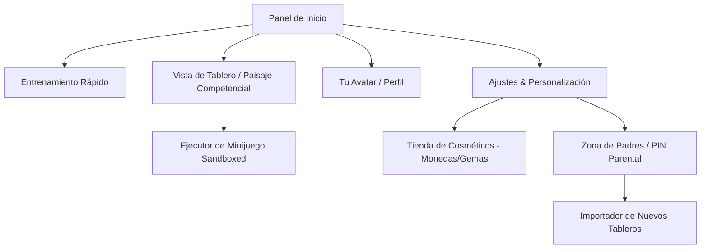
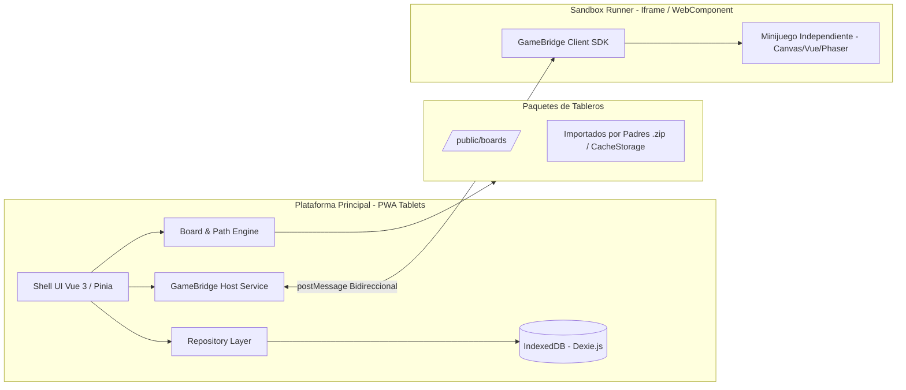
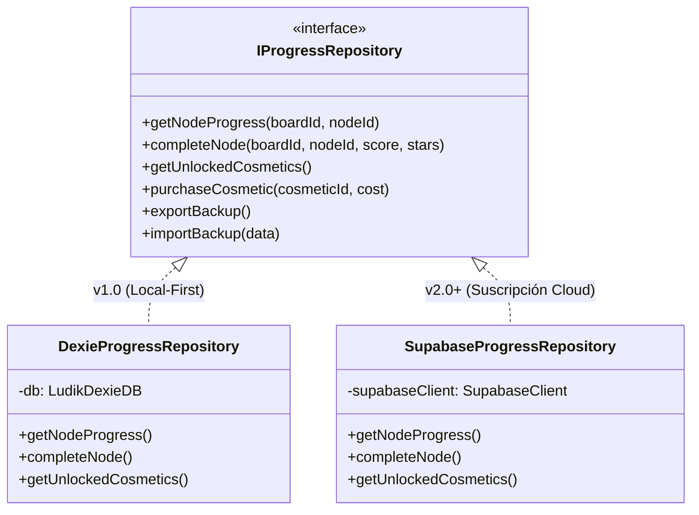

# Samsar|Games — Ludik: Especificación de Arquitectura y Producto (v1.0)

> **Ecosistema:** Samsar (`Samsar|Games`)  
> **Canal Didáctico:** Samsar (`Samsar|Dev`, `Samsar|Games`)  
> **Estado:** Borrador v1.0 (pendiente de revisión; no es una especificación aceptada)  
> **Fecha:** Octubre 2026  
> **Plataforma Objetivo:** Web App / PWA (Optimizada para Tablets) con arquitectura Local-First  

---

## 1. Visión Ejecutiva del Proyecto

### 1.1 Propósito Principal
**Samsar|Games — Ludik** es un entorno lúdico de ejecución y orquestación de minijuegos educativos diseñado para tabletas táctiles, enfocado en niños de escolaridad primaria (6 a 12 años).

La plataforma desacopla completamente el **entorno de ejecución (Core Runner)** del **contenido pedagógico (Paisajes Competenciales / Tableros de Minijuegos)**, permitiendo expandir infinitamente los mundos y temáticas de aprendizaje mediante manifiestos declarativos sin necesidad de reprogramar la aplicación principal.

### 1.2 Contexto Personal y Didáctico
- **Proyecto de vínculo familiar:** Creado por un padre desarrollador para su hijo, adaptado a sus intereses genuinos de aprendizaje (comenzando por el ajedrez).
- **Laboratorio de Arquitectura:** Demuestra cómo construir un sistema con principios sólidos:
  - **Clean / Hexagonal Architecture** en el frontend.
  - **Local-First Software** con persistencia en IndexedDB y capacidad offline total.
  - **Plugin / Sandboxing Architecture** mediante un SDK estándar (`GameBridge`) para minijuegos aislados.
  - **Preparado para escalar:** Evolución limpia hacia backend en la nube (Supabase / modelo de suscripción SaaS) mediante inversión de dependencias y el patrón Repository.

### 1.3 Principios Innegociables del Producto
1. **Zero Microtransacciones / Cero Dinero Real:** Bajo ningún concepto o versión la aplicación incluye pasarelas de pago, dinero real, compras integradas o publicidad. Todos los desbloqueables (avatares, fondos, estilos de barra) se ganan exclusivamente mediante esfuerzo lúdico.
2. **Revisitabilidad con Integridad Económica:** Los nodos y trayectos superados en el mapa son 100% rejugables para reforzar el aprendizaje, pero las recompensas base (monedas y gemas) se otorgan una única vez por hito para evitar grinding artificial.
3. **Privacidad Infantil por Diseño:** Al ser Local-First en v1.0, ningún dato personal o telemetría sale de la tableta.

---

## 2. Experiencia de Usuario y Especificación de Pantallas

La interfaz está orientada a niños en edad escolar primaria, con una estética visual colorida, botones táctiles amplios, retroalimentación sonora y gamificación visual inmediata.



### 2.1 Pantalla Principal: Panel de Inicio (Home)

- **Barra Lateral de Navegación:**
  - Logotipo del ecosistema (`Samsar|Games - Ludik`).
  - Botones principales con foco táctil grande: **Panel de Inicio**, **Perfil**, **Historial**, **Ajustes**.
  - Color y tema de la barra personalizable desde la tienda.
- **Barra Superior (Header):**
  - Identificador de perfil activo (ej. `Khalid Toledo`).
  - Marcador de **Gemas** (diamante violeta) y **Monedas** (moneda dorada).
  - Botón **Guía de Inicio Rápido** (icono de libro ilustrado con explicaciones visuales de la plataforma).
- **Tarjetas Centrales de Acción:**
  1. **Entrenamiento:** Botón de acción rápida para iniciar evaluaciones o sesiones cortas de práctica basadas en lo aprendido.
  2. **Paisaje Competencial:** Representación isométrica multicapa de los mundos.
     - Si la unidad está bloqueada: Muestra candado de seguridad y botón deshabilitado.
     - Si está desbloqueada: Muestra botón "INICIAR" para acceder al mapa activo.
  3. **Tu Avatar:** Muestra a cuerpo completo el avatar actual seleccionado (ej. robot futurista, superheroína, astronauta) y botón destacado "TU AVATAR" para ingresar a personalización.
- **Barra Inferior de Progreso:**
  - **Progreso por unidad:** Línea de tiempo visual con hasta 10 hitos numerados:
    - *Verde:* Hito completado con éxito.
    - *Amarillo:* Hito en curso / actual.
    - *Rojo:* Hito que requiere refuerzo o reintento.
    - *Gris con borde:* Hitos futuros pendientes de desbloquear.
  - **Progreso general:** Barra de porcentaje animada (ej. `15%`).

### 2.2 Vista de Tablero: "Paisaje Competencial"

- **Cabecera del Tablero:**
  - Botón Atrás (`←`) para retornar al Panel de Inicio.
  - Identificador de la unidad (ej. `UNIDAD 9: Movimiento de Torres`).
  - Botón "Siguiente Unidad" (habilitado al completar todos los nodos requeridos del trayecto).
- **Panel Lateral Izquierdo de Estado:**
  - **Caja de Metadatos Didácticos:** Resumen del objetivo de aprendizaje o temática del mapa.
  - **Previsualización de Avatar:** Avatar activo del niño.
  - **Racha Actual:** Indicador de racha (ej. `1 / 10`) con barra de nivel para bonificación de gemas.
  - **Puntos Acumulados:** Puntuación global de desempeño (ej. `75 pts`).
  - **Balance de Recompensas de la sesión:** Monedas ganadas (`+2`) y Gemas ganadas (`+2`).
  - **Acceso Directo a Tienda:** Botón "Comprar" con icono de tienda.
- **Lienzo Central del Paisaje (Mapa Isométrico / Grafo):**
  - Terreno ilustrado isométrico con caminos que conectan nodos de actividad.
  - **Estados visuales de los nodos:**
    - *Bloqueado:* Nodo en gris con icono de candado.
    - *Disponible / Siguiente:* Nodo brillante, pulsante y accesible.
    - *Completado:* Nodo con indicador de estrellas de calificación (1 a 3 estrellas según el desempeño en el minijuego).
  - Trazado de ruta con efecto visual de "camino recorrido" para que el niño reconozca visualmente su avance histórico.
  - Control de pantalla completa (`⛶`) para maximizar el área de juego en la tableta.

### 2.3 Pantalla de Ajustes y Tienda de Cosméticos

- **Ajustes 1 (Configuración y Perfil):**
  - Cambio de avatar activo mediante carrusel táctil.
  - Cambio de fondo de pantalla del sitio mediante carrusel táctil.
  - Control de seguridad: PIN Parental para ingresar a opciones avanzadas de sistema y gestión de tableros.
  - Botón directo "Ir a la tienda".
- **Ajustes 2 (Tienda de Cosméticos Gamificada):**
  - Pestañas superiores de categorías:
    1. **BARRA:** Paletas de color y estilos de gradiente para la barra lateral y superior (precios: 15, 35, 75 monedas).
    2. **FONDOS / TEMAS:** Ilustraciones temáticas para el fondo de la aplicación.
    3. **AVATARS:** Nuevos personajes, trajes y skins (robots, héroes, magos, exploradores).
    4. **PEGATINAS:** Coleccionables y stickers para personalizar el perfil.
  - Cada item exhibe su costo en monedas o gemas y un botón interactivo de adquisición ("Obtener"). Si el balance es insuficiente, muestra un mensaje lúdico que anima a jugar más retos para conseguir las monedas faltantes.

---

## 3. Arquitectura del Sistema y Extensibilidad



### 3.1 Stack Tecnológico
- **Frontend / Core:** **Vue 3** con Composition API (`<script setup lang="ts">`) + **TypeScript** estricto.
- **Estilos & UI:** **Tailwind CSS v4** con tokens de diseño adaptados a temas y fondos dinámicos.
- **PWA & Offline:** `@vite-pwa/plugin` con Service Worker para almacenamiento en caché de assets estáticos y bundles de minijuegos.
- **Persistencia Local-First:** **Dexie.js** (abstracción tipada sobre IndexedDB).
- **Gestor de Paquetes & Scripts:** **Bun** (alineado al repositorio SamsarSite).

### 3.2 Desacoplamiento de Tableros: El Manifiesto Declarativo
Los tableros no se programan de forma rígida en el código del shell. Cada tablero es un paquete autónomo definido por un archivo `board.manifest.json`:

```json
{
  "$schema": "https://samsardev.com/schemas/ludik-board-v1.json",
  "id": "chess-journey-v1",
  "title": "El Camino del Ajedrez",
  "category": "Estrategia & Lógica",
  "version": "1.0.0",
  "targetAge": [6, 12],
  "theme": {
    "primaryColor": "#e11d48",
    "backgroundLandscape": "assets/landscapes/isometric-chess-realm.svg",
    "ambientAudio": "assets/audio/gentle-quest.mp3"
  },
  "units": [
    {
      "id": "unit-1",
      "order": 1,
      "title": "Las Piezas y sus Pasos",
      "nodes": [
        {
          "id": "node-1-peon",
          "title": "El Valiente Peón",
          "description": "Aprende cómo avanza y corona el peón en el tablero.",
          "coordinates": { "x": 120, "y": 340 },
          "prerequisites": [],
          "gameEntry": "games/pawn-quest/index.html",
          "gameType": "iframe",
          "rewards": {
            "coins": 20,
            "gems": 2,
            "badgeId": "badge-pawn-master"
          },
          "maxStars": 3
        },
        {
          "id": "node-2-torre",
          "title": "La Torre Inquebrantable",
          "description": "Domina las filas y columnas con la torre.",
          "coordinates": { "x": 250, "y": 280 },
          "prerequisites": ["node-1-peon"],
          "gameEntry": "games/rook-charge/index.html",
          "gameType": "iframe",
          "rewards": {
            "coins": 25,
            "gems": 2
          },
          "maxStars": 3
        }
      ]
    }
  ]
}
```

### 3.3 Contrato de Comunicación de Minijuegos (`GameBridge` SDK)
Los minijuegos se ejecutan en un contenedor aislado (Iframe con sandbox o Web Component aislado) para garantizar que un fallo en el juego no congele la plataforma.

La comunicación se rige mediante un contrato tipado bidireccional vía `postMessage`:

| Dirección | Mensaje | Carga útil (Payload) | Descripción |
|---|---|---|---|
| **Game → Host** | `LUDIK_READY` | `{ gameId, version }` | El minijuego avisa que sus assets están listos. |
| **Host → Game** | `LUDIK_START` | `{ difficulty, theme, audioEnabled }` | La plataforma autoriza el arranque y pasa parámetros. |
| **Game → Host** | `LUDIK_PROGRESS` | `{ currentStep, totalSteps, score }` | Notificación intermedia de progreso o aciertos. |
| **Game → Host** | `LUDIK_COMPLETE` | `{ success: true, score, stars: 1-3, durationSeconds }` | Fin de la actividad con evaluación del resultado. |
| **Game → Host** | `LUDIK_EXIT` | `{ reason: 'user_cancel' \| 'restart' }` | Salida manual o reinicio por parte del jugador. |

**Seguridad del Host:**
El cálculo de entrega de monedas y gemas lo ejecuta **exclusivamente el Host**, verificando en base de datos si el nodo ya había sido superado previamente para no duplicar recompensas base.

### 3.4 Persistencia Local-First y Escalabilidad hacia Supabase



1. **v1.0 (MVP en Tableta):**
   - Implementación `DexieProgressRepository` guardando tablas:
     - `profiles`: Datos del perfil, avatar actual, fondo activo, PIN parental.
     - `node_progress`: Registro de nodos completados, estrellas obtenidas, fecha, si la recompensa ya fue cobrada.
     - `wallet`: Balance reactivo de monedas y gemas.
     - `inventory`: Cosméticos comprados y desbloqueados.
   - Función de importación/exportación JSON para copias de seguridad entre dispositivos del hogar.
2. **Evolución a v2.0+ (SaaS / Suscripción):**
   - Simplemente se implementa `SupabaseProgressRepository` satisfaciendo la misma interfaz `IProgressRepository`.
   - Se activan Row Level Security (RLS) y autenticación con Supabase Auth.
   - Las reglas de negocio y los componentes visuales permanecen 100% inalterados.

---

## 4. Primer Tablero: "El Camino del Ajedrez" (v1.0)

El ajedrez es el catalizador didáctico inicial de Ludik, diseñado sin rigideces curriculares pero con una curva de aprendizaje adaptada a niños de 6 a 12 años.

### 4.1 Fases Pedagógicas del Tablero de Ajedrez
1. **Unidad 1: Los Guerreros del Tablero (Movimiento y Geometría)**
   - *Nodo 1 (Peón):* Minijuego "Carrera de Peones" (avanzar casillas y coronar sin ser interceptado).
   - *Nodo 2 (Torre):* Minijuego "El Rayo de las Filas" (limpiar todas las estrellas en líneas rectas).
   - *Nodo 3 (Alfil):* Minijuego "El Guardián Diagonal" (recorrer sólo casillas del mismo color recogiendo gemas).
   - *Nodo 4 (Caballo):* Minijuego "El Salto en L" (resolver un laberinto en forma de L para alcanzar la meta).
   - *Nodo 5 (Dama y Rey):* Minijuego "El Baile Real" (combinación de poderes y la importancia de proteger al Rey).
2. **Unidad 2: El Arte de la Captura y el Valor de las Piezas**
   - Ejercicios tácticos donde el niño aprende qué pieza capturar analizando su valor simbólico (peón = 1, caballo/alfil = 3, torre = 5, dama = 9).
3. **Unidad 3: El Jaque y el Jaque Mate**
   - Escenarios tipo puzzle interactivo: cómo escapar de un jaque (Mover el rey, Bloquear con otra pieza, Capturar la pieza atacante) y reconocer un jaque mate elemental (ej. Mate del Pasillo, Mate del Pastor defensivo).

### 4.2 Modalidad "Entrenamiento"
- Accesible directamente desde el Panel de Inicio.
- Genera baterías rápidas de 5 a 10 ejercicios interactivos aleatorios basados **únicamente en los conceptos de nodos que el niño ya ha desbloqueado** en el paisaje competencial.
- Otorga pequeñas recompensas de monedas diarias para fomentar la constancia sin bloquear el avance del mapa principal.

---

## 5. Zona de Padres y Gestión de Contenido

Para mantener el control y permitir que el padre agregue nuevos tableros y retos:
- **PIN Parental:** Desafío aritmético aleatorio para niños (ej. `7 x 8 = ?`) o código PIN numérico de 4 dígitos configurado por el padre.
- **Cargador Híbrido de Tableros:**
  - **Tableros precargados:** Distribuidos estáticamente en la carpeta `/boards/` de la PWA.
  - **Importador de Paquetes (`.ludikpack` / ZIP):**
    - Permite al padre cargar un archivo comprimido que contenga `board.manifest.json` y su carpeta de assets/minijuegos directamente desde la tableta.
    - Los archivos se almacenan en el **CacheStorage** del navegador y el manifiesto en IndexedDB, quedando el nuevo juego listo para jugar sin necesidad de recompilar la PWA.

---

## 6. Criterios de Aceptación (Definición de Terminado v1.0)

1. **Rendimiento y Ergonomía Táctil:**
   - La aplicación debe ejecutarse fluidamente a 60 FPS en navegadores modernos de tableta (Safari iPadOS y Chrome Android).
   - Elementos interactivos con un tamaño táctil mínimo de 48x48 px.
2. **Aislamiento de Minijuegos:**
   - El minijuego de ajedrez debe comunicarse fluidamente mediante el contrato `GameBridge` sin provocar fugas de memoria o caídas de la interfaz base.
3. **Economía Segura:**
   - No existe ningún flujo de dinero real en ninguna parte del código.
   - Las monedas y gemas se acreditan fielmente y persisten tras recargar el navegador u operar sin conexión a internet.
4. **Verificación de Calidad:**
   - `bun run check` (validación estricta de tipos de TypeScript).
   - `bun run lint` (sin errores de linter ni accesibilidad).
   - `bun run build` (build de producción completado sin advertencias).
