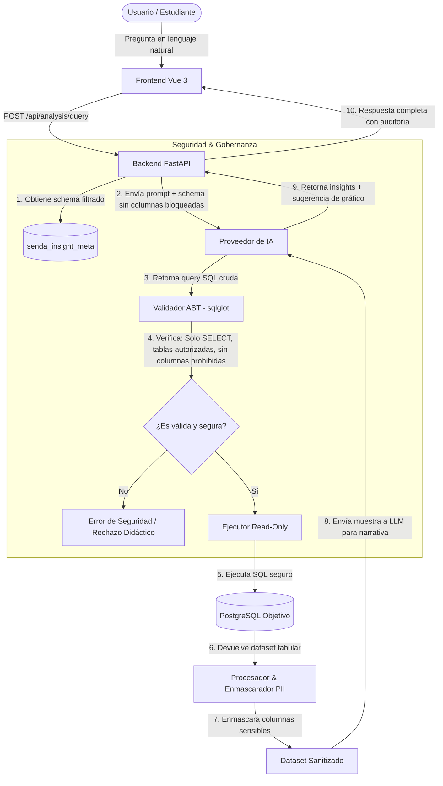

# Senda|Insight — Especificación Inicial (PoC)

> **Ecosistema:** Suite Senda (Comercial / Open-Source)  
> **Canal Didáctico:** Samsar (`Samsar|IA`, `Samsar|Dev`)  
> **Estado:** Especificación Inicial de Arquitectura (PoC)  
> **Fecha:** Octubre 2026  

---

## 1. Visión Ejecutiva del Proyecto

### 1.1 Propósito Principal
**Senda|Insight** es una plataforma web de inteligencia de negocios y analítica aumentada impulsada por Inteligencia Artificial. Su objetivo es transformar preguntas de negocio expresadas en lenguaje natural en consultas SQL seguras, ejecutarlas contra bases de datos relacionales empresariales y presentar visualizaciones interactivas junto a análisis narrativos de alto nivel.

### 1.2 Propósito Didáctico y Formativo
Servir como **laboratorio y caso de estudio de nivel producción** para estudiantes de ingeniería y desarrollo de software. El sistema demuestra la aplicación práctica de:
- **Principio de menor privilegio y defensa en profundidad** en arquitecturas con LLMs.
- **Validación sintáctica por AST (Abstract Syntax Tree)** para evitar inyecciones SQL y accesos indebidos.
- **Gobernanza granular de datos** (enmascaramiento y exclusión de PII / datos sensibles).
- **Cifrado de secretos en reposo** (AES-256 / Fernet).
- **Observabilidad y auditoría de IA:** Desmitificación del modelo mediante un panel de transparencia técnica.

### 1.3 Arquitectura de Marca y Ecosistema
- **Senda (Suite de Soluciones):** Ecosistema de productos donde `Senda|Insight` se suma a `Senda|Core` (ERP/Facturación), `Senda|Loyalty` (Fidelización) y `Senda|Concierge` (RAG / Base de conocimiento).
- **Samsar (Marca Personal / Educador):** Canal desde el cual se publican guías, tutoriales y laboratorios analizando las decisiones arquitectónicas de `Senda|Insight`.

---

## 2. Arquitectura del Sistema

### 2.1 Stack Tecnológico (Monorepo)
- **Backend:** Python 3.11+ con **FastAPI**.
  - *Data & AST:* `sqlglot` (análisis y reescritura AST de SQL), `psycopg3` (conexión a PostgreSQL), `polars` / `pandas` (agregación y manipulación de datos tabulares).
  - *Cifrado:* `cryptography` (Fernet / AES-256 para credenciales y API keys).
  - *Modelos & Validación:* `pydantic` v2.
  - *Migraciones:* `alembic`.
- **Frontend:** **Vue 3** con Composition API (`<script setup lang="ts">`).
  - *Tooling:* Vite + TypeScript.
  - *Estilos:* Tailwind CSS.
  - *Visualización de Datos:* Chart.js o Apache ECharts.
- **Bases de Datos & Infraestructura:** **Docker & Docker Compose**.
  - Servicio PostgreSQL que orquesta dos bases de datos lógicas:
    1. `senda_insight_meta`: Metadatos de la aplicación (configuraciones del wizard, permisos de tablas/columnas, auditoría de consultas y claves cifradas).
    2. `sample_enterprise_db`: Base de datos de ejemplo precargada con datos sintéticos de negocio (ventas, clientes con PII, inventario) para pruebas inmediatas de estudiantes.

### 2.2 Diagrama de Flujo de Datos y Seguridad

---

## 3. Especificación del Asistente Guiado (Setup Wizard)

Toda configuración del sistema se administra a través de un asistente paso a paso, persistiendo los datos de forma cifrada en `senda_insight_meta`.

### Paso 1: Conexión a la Base de Datos Objetivo
- Formulario de conexión: Motor (PostgreSQL / SQL), Host, Puerto, Usuario, Contraseña, Nombre de Base de Datos y SSL Mode.
- Botón **"Probar Conexión"**: Realiza un `SELECT 1;` y valida que el usuario posea permisos estrictos de lectura.
- Opción rápida para estudiantes: *"Usar base de datos didáctica precargada (`sample_enterprise_db`)"*.

### Paso 2: Gobernanza de Tablas y Columnas (3 Niveles de Privacidad)
El sistema ejecuta un escaneo del catálogo (`information_schema`) y lista las tablas disponibles.
- **Selector de Tablas:** Checkbox para habilitar o inhabilitar la lectura de cada tabla.
- **Nivel de Privacidad por Columna:** Para cada tabla habilitada, el usuario clasifica cada campo en uno de 3 niveles:
  1. **Visible (Pública):** La columna se incluye en el schema enviado al LLM y puede proyectarse libremente.
  2. **Enmascarada (Masked / PII protegida):** La IA conoce su existencia para poder aplicar filtros o agrupaciones (ej. `GROUP BY`), pero al momento de extraer los datos para el usuario final o enviarlos al modelo, el backend aplica una función de anonimización (ej. `j***@empresa.com` o hash).
  3. **Bloqueada (Hidden / Prohibida):** Se elimina 100% del schema provisto al LLM. Si el LLM intenta adivinarla o proyectarla, el validador AST aborta la consulta inmediatamente.

### Paso 3: Configuración del Proveedor de IA
Arquitectura modular mediante Adapter Pattern (`LLMProvider`):
- **Proveedores contemplados para el PoC:**
  - **Claude (Anthropic API):** Requiere API Key y selección de modelo (ej. `claude-3-5-sonnet`).
  - **Antigravity (Google / Vertex API):** Requiere credenciales/API Key y selección de modelo (ej. `gemini-1.5-pro`).
  - **Ollama (Instancia Local):** Requiere URL del endpoint (ej. `http://localhost:11434` o `http://host.docker.internal:11434`) y selección de modelo local descargado (ej. `llama3.1`, `qwen2.5-coder`).
- Botón **"Probar Proveedor"**: Envía un prompt mínimo de prueba de conexión y valida la respuesta.

### Paso 4: Resumen y Cifrado
- Visualización de la política de seguridad acordada.
- Los secretos (contraseñas de BD y API keys) son cifrados con AES-256 (Fernet) utilizando una `APP_SECRET_KEY` antes de ser almacenados en `senda_insight_meta`.

---

## 4. Experiencia de Usuario y Salida Analítica

La interfaz de resultados se estructura en una **Vista Analítica Integral** compuesta por 4 áreas:

1. **Resumen Ejecutivo:**
   - Hallazgos clave, anomalías detectadas y narrativa de negocio formateada en Markdown.
2. **Gráficos Dinámicos:**
   - Representación visual interactiva (barras, líneas temporales, dispersión o torta) generada a partir de los datos y la sugerencia estructural de la IA.
3. **Tabla de Datos Sanitizada:**
   - Vista tabular interactiva de los registros devueltos por la consulta, con los filtros de enmascaramiento aplicados.
4. **Panel de Auditoría Técnica ("Modo Didáctico"):**
   - Acordeón colapsable para estudiantes y auditores que expone:
     - Consulta SQL exacta generada por el LLM.
     - Informe del Validador AST (tablas analizadas, validación de sólo lectura, verificación de cláusula `LIMIT`, columnas filtradas/enmascaradas).
     - Proveedor utilizado, modelo, latencia (ms) y consumo de tokens.

---

## 5. Hoja de Ruta y Extensiones Futuras

- **Fase 2 — Integración de Capa Semántica RAG (`Senda|Concierge`):**  
  Desacoplar el generador directo de Text-to-SQL para permitir que preguntas complejas consulten primero la base de conocimiento semántica y el catálogo de métricas unificado de `Senda|Concierge`.
- **Fase 3 — Exportación de Informes:**  
  Generación de reportes ejecutivos en PDF y Markdown con los gráficos incrustados.
- **Fase 4 — Alertas Automáticas:**  
  Configuración de análisis programados recurrentes sobre variaciones críticas en la base de datos de negocio.