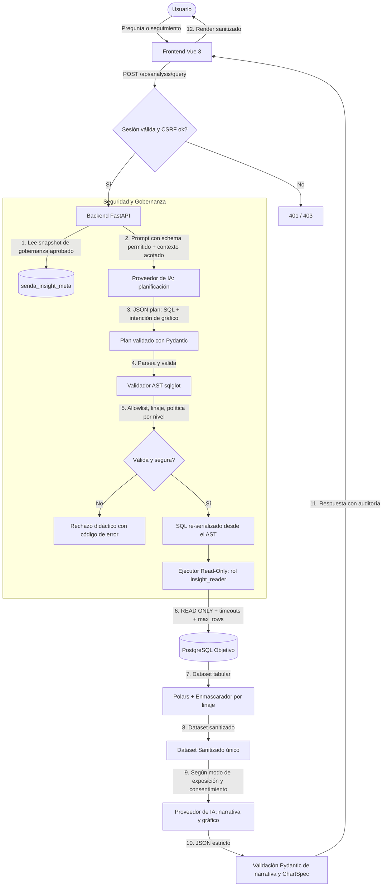

# Senda|Insight — Especificación (PoC) v1.1

> **Ecosistema:** Suite Senda (Comercial / Open-Source)
> **Canal Didáctico:** Samsar (`Samsar|IA`, `Samsar|Dev`)
> **Estado:** Especificación de Arquitectura (PoC) — revisada
> **Versión:** 1.1 | **Fecha:** Octubre 2026
> **Cambios v1.1:** Incorpora las correcciones de bloqueo B1–B6 de la revisión técnica y las decisiones de diseño P1–P7. Las sugerencias no bloqueantes (S1–S10) se documentan por separado en `senda-insight-suggestions.md`. Ver [Changelog](#14-changelog).

---

## Tabla de Contenidos

1. [Visión Ejecutiva del Proyecto](#1-visión-ejecutiva-del-proyecto)
2. [Arquitectura del Sistema](#2-arquitectura-del-sistema)
3. [Autenticación y Exposición de la Aplicación](#3-autenticación-y-exposición-de-la-aplicación)
4. [Gestión de Secretos y Cifrado](#4-gestión-de-secretos-y-cifrado)
5. [Asistente de Configuración (Wizard)](#5-asistente-de-configuración-wizard)
6. [Política del Validador AST](#6-política-del-validador-ast)
7. [Capa de Base de Datos y Ejecutor Read-Only](#7-capa-de-base-de-datos-y-ejecutor-read-only)
8. [Datos hacia el Proveedor LLM](#8-datos-hacia-el-proveedor-llm)
9. [Contexto Conversacional (Consultas de Seguimiento)](#9-contexto-conversacional-consultas-de-seguimiento)
10. [Experiencia de Usuario y Salida Analítica](#10-experiencia-de-usuario-y-salida-analítica)
11. [Limitaciones Conocidas](#11-limitaciones-conocidas)
12. [Criterios de Aceptación de Seguridad](#12-criterios-de-aceptación-de-seguridad)
13. [Hoja de Ruta y Extensiones Futuras](#13-hoja-de-ruta-y-extensiones-futuras)
14. [Changelog](#14-changelog)

---

## 1. Visión Ejecutiva del Proyecto

### 1.1 Propósito Principal
**Senda|Insight** es una plataforma web de inteligencia de negocios y analítica aumentada impulsada por Inteligencia Artificial. Su objetivo es transformar preguntas de negocio expresadas en lenguaje natural en consultas SQL seguras, ejecutarlas contra bases de datos relacionales empresariales y presentar visualizaciones interactivas junto a análisis narrativos de alto nivel.

### 1.2 Propósito Didáctico y Formativo
Servir como **laboratorio y caso de estudio de nivel producción** para estudiantes de ingeniería y desarrollo de software. El sistema demuestra la aplicación práctica de:
- **Principio de menor privilegio y defensa en profundidad** en arquitecturas con LLMs.
- **Validación sintáctica por AST (Abstract Syntax Tree)** para evitar inyecciones SQL y accesos indebidos.
- **Gobernanza granular de datos** (enmascaramiento y exclusión de PII / datos sensibles).
- **Cifrado de secretos en reposo** con gestión explícita de claves.
- **Tratamiento de la salida del LLM como entrada no confiable** (validación de esquemas, sanitización de Markdown).
- **Observabilidad y auditoría de IA:** desmitificación del modelo mediante un panel de transparencia técnica.

### 1.3 Arquitectura de Marca y Ecosistema
- **Senda (Suite de Soluciones):** Ecosistema de productos donde `Senda|Insight` se suma a `Senda|Core` (ERP/Facturación), `Senda|Loyalty` (Fidelización), `Senda|Concierge` (RAG / Base de conocimiento) y `Senda|SSO` (Autenticación).
- **Samsar (Marca Personal / Educador):** Canal desde el cual se publican guías, tutoriales y laboratorios analizando las decisiones arquitectónicas de `Senda|Insight`.

### 1.4 Alcance y Supuestos de Diseño

| Tema | Decisión del PoC | Dónde se enseña el tema completo |
|---|---|---|
| **Usuarios** | Una sola persona (administrador/usuario único) | — |
| **Gobernanza de datos** | **Global**: una única política de tablas/columnas aplica a todas las consultas. No existe gobernanza por rol. | `Senda\|Core` (gobernanza por rol) |
| **Autenticación** | Mínima y local (un administrador), detrás de una interfaz `AuthProvider` reemplazable | `Senda\|SSO` (autenticación/SSO) |
| **Motor de BD objetivo** | PostgreSQL (los controles de la capa de BD de la §7 usan características propias de PostgreSQL) | — |
| **Despliegue** | Local / red privada con Docker Compose, enlazado a `127.0.0.1` por defecto | — |

> **Importante:** toda la planificación de seguridad de este documento **asume gobernanza global y un único usuario**. Si el sistema evolucionara a múltiples usuarios con permisos distintos, la política de la §5.2 y la capa de BD de la §7 deberían parametrizarse por rol (ver `Senda|Core`).

### 1.5 Modelo de Amenazas (resumen)

El diseño parte de que **tres fuentes de datos no son confiables**:

| Fuente | Por qué no es confiable | Mitigación principal |
|---|---|---|
| **Salida del LLM (SQL)** | Puede alucinar o ser manipulada por prompt injection | Validador AST + permisos reales en BD (§6, §7) |
| **Contenido de la BD objetivo** | Una celda puede contener instrucciones ("ignora lo anterior…") — *prompt injection indirecto* | Delimitación, sin herramientas para el LLM, validación de salida (§8) |
| **Salida del LLM (narrativa/gráfico)** | Puede contener HTML/Markdown malicioso o enlaces de exfiltración | Esquemas Pydantic estrictos + sanitización (§10.4) |

Adversarios considerados: (a) el propio LLM equivocado, (b) un tercero con acceso de red a la app, (c) contenido malicioso dentro de la BD objetivo, (d) un usuario curioso que intenta extraer columnas protegidas por inferencia.

---

## 2. Arquitectura del Sistema

### 2.1 Stack Tecnológico (Monorepo)
- **Backend:** Python 3.11+ con **FastAPI**.
  - *Data & AST:* `sqlglot` (análisis, resolución de columnas y linaje por AST), `psycopg` v3 (conexión a PostgreSQL), **`polars`** (única librería de dataframes; ver §2.5).
  - *Cifrado:* `cryptography` (`Fernet` / `MultiFernet`).
  - *Autenticación:* `argon2-cffi` (hash de contraseña Argon2id).
  - *Modelos & Validación:* `pydantic` v2.
  - *Migraciones:* `alembic`.
- **Frontend:** **Vue 3** con Composition API (`<script setup lang="ts">`).
  - *Tooling:* Vite + TypeScript.
  - *Estilos:* Tailwind CSS.
  - *Visualización de Datos:* Apache ECharts **o** Chart.js (se elige una; ver §10.3).
  - *Markdown seguro:* `markdown-it` (HTML deshabilitado) + `DOMPurify` (ver §10.4).
- **Bases de Datos & Infraestructura:** **Docker & Docker Compose**.
  - Servicio PostgreSQL que orquesta dos bases de datos lógicas:
    1. `senda_insight_meta`: metadatos de la aplicación (configuración, gobernanza versionada, auditoría, sesiones, secretos cifrados).
    2. `sample_enterprise_db`: base de datos de ejemplo con datos sintéticos (ventas, clientes con PII, inventario), con su rol de lectura `insight_reader` ya aprovisionado por script de inicialización.

### 2.2 Capas de Defensa

Ninguna capa depende de que otra funcione correctamente. El fallo de una no debe comprometer los datos protegidos.

| Capa | Mecanismo | Qué cubre si las demás fallan |
|---|---|---|
| **0. Acceso a la app** | Autenticación, enlace a `127.0.0.1`, CSRF (§3) | Terceros no pueden usar ni reconfigurar el sistema |
| **1. Schema mínimo al LLM** | El prompt solo incluye lo aprobado y no bloqueado | El LLM no conoce columnas bloqueadas |
| **2. Validador AST** | Allowlist de nodos/funciones, linaje de columnas, política por nivel (§6) | Bloquea SQL fuera de política |
| **3. Rol y transacción en BD** | `GRANT SELECT` por columna, `READ ONLY`, timeouts (§7) | Aunque el AST tenga un bug, la BD niega lo bloqueado |
| **4. Enmascaramiento de resultados** | Anonimización por linaje antes de mostrar o enviar al LLM (§6.6) | Valores enmascarados no salen del backend |
| **5. Control de salida** | Esquemas Pydantic + sanitización de Markdown + CSP (§8, §10) | Narrativa/gráfico maliciosos no ejecutan nada en el navegador |

### 2.3 Diagrama de Flujo de Datos y Seguridad



### 2.4 Despliegue y Exposición de Red (Docker Compose)

- Los puertos se publican **solo en loopback**: `127.0.0.1:8000:8000` (API) y `127.0.0.1:5173:5173` (frontend en desarrollo). Cambiarlo requiere una decisión explícita documentada.
- El servicio PostgreSQL de metadatos **no publica puertos** al host. La BD `sample_enterprise_db` se publica, si se desea, solo en `127.0.0.1`.
- Los secretos se montan como **Docker secrets** (archivos), no como variables de entorno en claro en `docker-compose.yml` (ver §4).
- Para exposición fuera de la máquina local se exige un reverse proxy con TLS; está fuera del alcance del PoC y se documenta como guía separada.
- Cabeceras de seguridad y CSP estricta en las respuestas del frontend (ver §10.4).

### 2.5 Decisión: una sola librería de dataframes (Polars)

Se elimina `pandas` y se conserva **Polars** por: tipado estricto (los tipos del resultado se conocen y validan), operaciones vectorizadas para enmascarar columnas, evaluación de resúmenes estadísticos (§8) con una sola librería, menor consumo de memoria y ausencia de semántica de índices, que es una fuente frecuente de errores. El volumen está acotado por `max_rows` (§7.3), por lo que no se requiere más. Los resultados se leen con `psycopg` y se cargan con `pl.DataFrame(rows, schema=..., orient="row")`.

---

## 3. Autenticación y Exposición de la Aplicación

> La autenticación completa y el SSO son materia de `Senda|SSO`. Este PoC implementa el mínimo indispensable para no dejar la aplicación abierta, detrás de una abstracción reemplazable.

### 3.1 Requisitos

| Requisito | Especificación |
|---|---|
| **Usuario** | Un administrador único, creado en el primer arranque |
| **Bootstrap seguro** | En el primer arranque, el backend genera un **token de un solo uso** (impreso en logs de arranque / archivo local). Crear el administrador exige ese token, evitando que un tercero en la red "reclame" la instancia primero |
| **Hash de contraseña** | Argon2id (`argon2-cffi`), longitud mínima de 12 caracteres |
| **Sesión** | Cookie `HttpOnly`, `SameSite=Strict`, `Secure` cuando haya TLS; sesión del lado del servidor con expiración por inactividad |
| **CSRF** | `SameSite=Strict` + token CSRF en peticiones que modifican estado |
| **Fuerza bruta** | Retraso progresivo y bloqueo temporal tras intentos fallidos |
| **Protección de endpoints** | Todo `/api/*` exige sesión, excepto `/api/auth/*` y `/health`. Los endpoints del wizard y de gobernanza exigen sesión de administrador |
| **CORS** | Origen único configurado; sin comodines |
| **Interfaz** | `AuthProvider` (puerto) con implementación `LocalAuthProvider`; permite sustituirla por `Senda|SSO` sin tocar el resto |

### 3.2 Endpoints de autenticación (mínimos)

| Endpoint | Función |
|---|---|
| `POST /api/auth/bootstrap` | Crea el administrador (requiere token de un solo uso; deja de funcionar tras usarse) |
| `POST /api/auth/login` | Inicia sesión |
| `POST /api/auth/logout` | Cierra sesión |
| `GET /api/auth/me` | Estado de sesión |

---

## 4. Gestión de Secretos y Cifrado

### 4.1 Corrección del algoritmo
La versión inicial indicaba "AES-256 (Fernet)". **Fernet utiliza AES-128-CBC con HMAC-SHA256** (clave de 32 bytes: 16 para cifrado y 16 para autenticación). Se mantiene **Fernet** por su resistencia al mal uso (cifrado autenticado, sin parámetros que configurar), lo cual es preferible en un proyecto didáctico; se corrige la documentación para decir lo que realmente es. Si en el futuro se requiriera AES-256, se usaría AES-256-GCM con nonce único por cifrado.

### 4.2 Ciclo de vida de la clave

| Aspecto | Especificación |
|---|---|
| **Nombre** | `APP_SECRET_KEYS` (lista: la primera cifra; todas descifran) |
| **Origen** | Docker secret / archivo (`APP_SECRET_KEYS_FILE=/run/secrets/app_secret_keys`). Nunca en el repositorio ni en `senda_insight_meta` |
| **Generación** | Comando `init-keys` del CLI de la app: ejecuta `Fernet.generate_key()`, guarda el archivo con permisos `0600` bajo `./secrets/` (incluido en `.gitignore`) |
| **Arranque** | **Falla cerrada:** si no hay clave válida, la app no arranca. Se rechazan valores de ejemplo conocidos |
| **Rotación** | `MultiFernet`: se antepone la clave nueva a la lista y se ejecuta `rotate-keys`, que re-cifra todos los secretos con `MultiFernet.rotate()`. Luego se retira la clave antigua |
| **Pérdida de clave** | Los secretos almacenados son irrecuperables; se vuelven a introducir desde el wizard. Documentado en el README |
| **Respaldo** | La clave se respalda por separado de los respaldos de la BD de metadatos |

### 4.3 Reglas de manejo
- Los secretos (contraseñas de BD, API keys) son de **solo escritura** desde la API: las respuestas devuelven `has_value: true` y un valor enmascarado, nunca el secreto.
- Redacción de secretos en logs (filtro de logging) y en el panel de auditoría.
- Los secretos se descifran en memoria solo en el instante de uso.

---

## 5. Asistente de Configuración (Wizard)

### 5.1 Naturaleza del Wizard: reentrante y editable

El wizard **no es de una sola ejecución**. Se ejecuta de forma guiada en el primer uso y permanece accesible como **"Configuración"** con cada paso editable de forma independiente.

- Cada cambio de gobernanza genera una **nueva versión** (`governance_version`) inmutable, con registro de quién, cuándo y qué cambió.
- Las consultas siempre usan el **último snapshot aprobado**, nunca el catálogo "en vivo".
- Al cambiar la gobernanza se invalida cualquier caché de schema del LLM y se vuelve a exigir la verificación de permisos en BD (§5.3).

### 5.2 Paso 0: Creación del Administrador
Ver §3. Es el único paso que se ejecuta una sola vez.

### 5.3 Paso 1: Conexión a la Base de Datos Objetivo
- Formulario: Host, Puerto, Usuario (rol de lectura), Contraseña, Nombre de BD y SSL Mode. Motor: PostgreSQL.
- **Opción rápida para estudiantes:** *"Usar base de datos didáctica precargada (`sample_enterprise_db`)"* (rol `insight_reader` ya aprovisionado).
- Botón **"Probar Conexión"**. No solo ejecuta `SELECT 1;`, sino que **verifica que el rol realmente sea de mínimo privilegio** (consultando `pg_catalog`):
  - No es superusuario ni tiene `CREATEROLE`, `CREATEDB`, `REPLICATION` ni `BYPASSRLS`.
  - No tiene privilegios `INSERT`, `UPDATE`, `DELETE`, `TRUNCATE` sobre ninguna tabla (`has_table_privilege`).
  - No es propietario de objetos ni miembro de roles privilegiados.
  - `default_transaction_read_only = on` a nivel de rol (advertencia si no lo está; la app igualmente abre transacciones `READ ONLY`).
- Si alguna verificación falla, la conexión se **rechaza** con un mensaje explicativo. La app nunca pide credenciales de administrador de la BD objetivo.

### 5.4 Paso 2: Gobernanza de Tablas y Columnas (3 Niveles de Privacidad)

**Escaneo del catálogo.** El escaneo usa `pg_catalog` (`pg_class`, `pg_attribute`), que lista todos los objetos con independencia de los permisos del rol. No se usa `information_schema`, que solo muestra lo que el rol ya puede ver y ocultaría justo lo que se debe gobernar.

- **Selector de Tablas:** habilita o inhabilita la lectura de cada tabla. **Por defecto: inhabilitada.**
- **Nivel de Privacidad por Columna** (por defecto: **Bloqueada**):

| Nivel | Schema enviado al LLM | Uso permitido en SQL | Tratamiento del resultado |
|---|---|---|---|
| **Visible** | Sí | Cualquiera (proyección, filtros, agrupación, orden, agregación) | Sin cambios |
| **Enmascarada** | Sí (nombre y tipo) | Ver matriz de §6.4: **no** en `WHERE`, `JOIN ON`, `ORDER BY`, `HAVING` ni funciones; sí en proyección directa, `GROUP BY` y `COUNT(DISTINCT)` | Se anonimiza en el backend antes de mostrar o enviar al LLM |
| **Bloqueada** | No (eliminada del schema) | **Ninguno:** cualquier aparición en el AST aborta la consulta | No aplica; además la BD niega el acceso (§7) |

**Deriva de schema (elementos nuevos).** Las tablas y columnas que aparezcan en la BD objetivo después de la última aprobación quedan **ocultas por defecto** (tablas inhabilitadas, columnas bloqueadas):
- La allowlist y el schema del LLM se construyen **solo del snapshot aprobado**, de modo que un elemento nuevo no puede filtrarse aunque nadie lo revise.
- La UI muestra una insignia **"Elementos nuevos por revisar"** al detectar diferencias (comparación del catálogo contra el snapshot, con huella hash).
- Columnas o tablas eliminadas o renombradas se marcan como **huérfanas** y requieren revisión.

**Aprovisionamiento de permisos y verificación.**
1. Al guardar la gobernanza, la app **genera un script SQL** de aprovisionamiento que el administrador ejecuta con sus propios privilegios. La app nunca lo ejecuta.
2. El script revoca todo y concede únicamente `GRANT SELECT (col1, col2, …)` **a nivel de columna** (nunca a nivel de tabla, para que una columna nueva no quede concedida por herencia):

```sql
-- Generado por Senda|Insight — governance_version = 7
REVOKE ALL ON ALL TABLES IN SCHEMA public FROM insight_reader;
GRANT USAGE ON SCHEMA public TO insight_reader;
GRANT SELECT (id, nombre, region, email) ON public.clientes TO insight_reader;
GRANT SELECT (id, cliente_id, fecha, total) ON public.ventas TO insight_reader;
-- 'salario' y 'telefono' (Bloqueadas) no se conceden.
```

3. Botón **"Verificar permisos en BD"**: para cada columna comprueba `has_column_privilege` y contrasta con la clasificación (Bloqueada o tabla inhabilitada → debe ser `false`; Visible/Enmascarada → `true`). También detecta concesiones heredadas de `PUBLIC`.
4. Mientras la verificación no esté en estado **OK para la versión de gobernanza vigente**, el análisis permanece deshabilitado (**falla cerrada**). Para `sample_enterprise_db` la verificación se pasa automáticamente.

### 5.5 Paso 3: Configuración del Proveedor de IA y Exposición de Datos
Arquitectura modular mediante Adapter Pattern (`LLMProvider`):
- **Proveedores contemplados para el PoC:**
  - **Claude (Anthropic API):** API Key y selección de modelo (ej. `claude-3-5-sonnet`).
  - **Antigravity (Google / Vertex API):** credenciales/API Key y selección de modelo (ej. `gemini-1.5-pro`).
  - **Ollama (Instancia Local):** URL del endpoint (ej. `http://localhost:11434` o `http://host.docker.internal:11434`) y modelo local (ej. `llama3.1`, `qwen2.5-coder`).
- Botón **"Probar Proveedor"**: envía un prompt mínimo y valida la respuesta.
- **Modo de exposición de resultados al LLM** (ver §8.1): `none` / `aggregates` / `sample`, con aviso y consentimiento explícito para proveedores externos.

### 5.6 Paso 4: Resumen y Cifrado
- Visualización de la **política de seguridad vigente**: versión de gobernanza, estado de verificación en BD, modo de exposición al LLM y proveedor.
- Los secretos se cifran con Fernet usando la clave descrita en §4 antes de almacenarse en `senda_insight_meta`.

---

## 6. Política del Validador AST

Esta sección es la especificación normativa del validador (`sqlglot`, dialecto `postgres`). La regla general es **allowlist, no denylist**: lo que no está explícitamente permitido, se rechaza.

### 6.1 Principio de canonicalización
**El SQL que se ejecuta no es el texto que devolvió el LLM**, sino el resultado de **re-serializar el AST validado** (`expression.sql(dialect="postgres")`). Esto elimina los comentarios y reduce los ataques de *diferencial de parser* (SQL que `sqlglot` interpreta de una forma y PostgreSQL de otra). La capa de BD (§7) cubre el riesgo residual.

### 6.2 Pipeline de validación

| # | Etapa | Regla | Código de rechazo |
|---|---|---|---|
| 1 | **Parseo** | Debe parsear sin errores; exactamente **una** sentencia | `E_PARSE`, `E_MULTI_STATEMENT` |
| 2 | **Tipo raíz** | Solo `SELECT` (o `UNION`/`INTERSECT`/`EXCEPT` de `SELECT`, con `WITH` no recursivo) | `E_NOT_SELECT` |
| 3 | **Allowlist de nodos** | Solo los nodos de §6.3 | `E_NODE_NOT_ALLOWED` |
| 4 | **Sin `*`** | `SELECT *` y `tabla.*` se rechazan (el LLM debe listar columnas) | `E_STAR` |
| 5 | **Resolución** | Se califican todas las columnas (alias, CTEs, subconsultas, ambigüedad en joins) con `sqlglot.optimizer.qualify` contra el **schema completo interno** (incluye bloqueadas, para detectarlas en vez de fallar como "columna desconocida") | `E_UNRESOLVED_COLUMN` |
| 6 | **Tablas y esquemas** | Cada tabla debe pertenecer a la allowlist del snapshot aprobado. Se rechazan `pg_catalog`, `information_schema`, otros esquemas y referencias entre bases de datos | `E_TABLE_NOT_ALLOWED`, `E_SCHEMA_NOT_ALLOWED` |
| 7 | **Funciones** | Solo las de la allowlist (§6.3). Toda función desconocida (nodo `Anonymous`) se rechaza | `E_FUNCTION_NOT_ALLOWED` |
| 8 | **Política por nivel de columna** | Matriz de §6.4, evaluada sobre el **linaje** de cada columna | `E_COLUMN_BLOCKED`, `E_MASKED_MISUSE` |
| 9 | **Complejidad** | Límite de nodos del AST, profundidad de subconsultas y número de joins | `E_COMPLEXITY` |
| 10 | **Informe** | Se genera el informe para el panel de auditoría (§10.5) | — |

### 6.3 Allowlists

**Nodos permitidos:** `Select`, `Union`/`Intersect`/`Except`, `With`/`CTE` (no recursivo), `Subquery`, `Join` (inner, left, right, full, cross), `Where`, `Group`, `Having`, `Order`, `Limit`, `Offset`, `Window`, `Case`, `Cast`, `Extract`, `Interval`, literales, operadores binarios/unarios, `In`, `Between`, `Like`, `Is`, `Paren`, `Alias`, `Column`, `Table`.

**Funciones permitidas (conjunto inicial, ampliable por configuración):**

| Familia | Funciones |
|---|---|
| Agregación | `COUNT`, `SUM`, `AVG`, `MIN`, `MAX` |
| Fecha/hora | `DATE_TRUNC`, `EXTRACT`, `CURRENT_DATE`, `NOW` |
| Numéricas | `ROUND`, `ABS`, `CEIL`, `FLOOR` |
| Texto | `LOWER`, `UPPER`, `COALESCE`, `NULLIF` |

**Rechazos explícitos que deben cubrirse con pruebas** (el rechazo ya ocurre por no estar en la allowlist; la lista sirve como casos de prueba): `pg_read_file`, `pg_read_binary_file`, `pg_ls_dir`, `pg_sleep`, `dblink`, `lo_import`, `lo_export`, `set_config`, `current_setting`, `pg_terminate_backend`, `query_to_xml`, `COPY`, `SELECT … INTO`, `FOR UPDATE/SHARE`, `SET`, `CREATE/ALTER/DROP`, `INSERT/UPDATE/DELETE`, funciones de conjuntos en `FROM` (`generate_series`, `unnest`), parámetros (`$1`, `:x`).

### 6.4 Matriz de Política por Nivel de Columna

| Contexto | Visible | Enmascarada | Bloqueada |
|---|---|---|---|
| Proyección directa (`SELECT col`) | ✅ | ✅ (valor enmascarado después) | ❌ |
| Proyección dentro de expresión o función (`SUBSTR(col,…)`, `col \|\| 'x'`) | ✅ | ❌ | ❌ |
| `WHERE` | ✅ | ❌ | ❌ |
| `JOIN … ON` | ✅ | ❌ | ❌ |
| `GROUP BY` | ✅ | ✅ | ❌ |
| `ORDER BY` (incluye `ORDER BY` dentro de funciones de ventana) | ✅ | ❌ | ❌ |
| `HAVING` | ✅ | ❌ | ❌ |
| `PARTITION BY` en ventanas | ✅ | ✅ | ❌ |
| `COUNT(DISTINCT col)` | ✅ | ✅ | ❌ |
| `MIN`/`MAX`/`SUM`/`AVG`/`COUNT(col)` | ✅ | ❌ | ❌ |
| `CASE`, `CAST`, `LIKE`, `IN`, comparaciones | ✅ | ❌ | ❌ |

**Justificación:**
- **`WHERE` no se permite sobre columnas enmascaradas ni bloqueadas** (decisión de diseño P2). Con `WHERE email LIKE 'a%'` o `WHERE email = 'x'` un usuario podría reconstruir el valor por búsqueda binaria (*ataque de oráculo*) sin proyectarlo nunca.
- La misma lógica extiende la prohibición a `ORDER BY`, `HAVING`, `JOIN ON`, funciones y agregados de valor (`MIN`/`MAX`), que son canales equivalentes de inferencia. Si se quisiera relajar alguna de estas, debe documentarse como limitación conocida (§11).
- La proyección **solo** como columna desnuda garantiza que el enmascarador pueda aplicarse sobre el valor completo; una expresión (`SUBSTR(email,1,1)`) produciría un valor derivado que escaparía al enmascaramiento.

### 6.5 Linaje de columnas
El validador evalúa la política sobre el **origen** de cada columna, no sobre su nombre o alias. Para ello usa la resolución de `sqlglot` y su análisis de linaje:
- Un alias o columna que atraviesa CTEs/subconsultas (`WITH x AS (SELECT email AS a FROM clientes) SELECT a FROM x`) **hereda el nivel** de su origen.
- Si una columna de salida mezcla orígenes de distinto nivel (por ejemplo en un `UNION` que combina una enmascarada con una visible en la misma posición), se aplica el nivel más restrictivo; si el linaje es ambiguo, se rechaza (`E_LINEAGE_AMBIGUOUS`).
- Identificadores entre comillas y diferencias de mayúsculas/minúsculas se normalizan antes de comparar (`"Email"` ≡ `email` según las reglas de PostgreSQL).

### 6.6 Enmascarador de resultados
- El validador devuelve un `mask_map`: **columna de salida → regla de enmascaramiento**, derivado del linaje.
- El procesador (Polars) aplica el `mask_map` al dataset completo **antes** de cualquier uso posterior (tabla, gráfico, envío al LLM).
- Es una regla de **fallo cerrado**: si una columna de salida no puede mapearse con certeza a un nivel, la consulta se rechaza.

---

## 7. Capa de Base de Datos y Ejecutor Read-Only

El validador AST es una capa; la **base de datos es la última barrera**. El ejecutor se define a nivel de motor, no solo de aplicación.

### 7.1 Rol dedicado
- Rol `insight_reader`: `LOGIN NOSUPERUSER NOCREATEDB NOCREATEROLE NOREPLICATION NOBYPASSRLS`.
- Solo `GRANT SELECT (columnas)` sobre lo aprobado (§5.4). Sin `GRANT` a nivel de tabla ni `ALTER DEFAULT PRIVILEGES`.
- Parámetros fijados a nivel de rol (aplican aunque falle la app):

```sql
ALTER ROLE insight_reader SET default_transaction_read_only = on;
ALTER ROLE insight_reader SET statement_timeout = '10s';
ALTER ROLE insight_reader SET lock_timeout = '2s';
ALTER ROLE insight_reader SET idle_in_transaction_session_timeout = '15s';
ALTER ROLE insight_reader SET search_path = public;
```

### 7.2 Transacción por consulta
Cada ejecución usa una conexión de `psycopg` con `read_only=True` (transacción `READ ONLY`), `statement_timeout` y `lock_timeout` explícitos, `application_name = 'senda-insight'` y un pool pequeño. Tras cada consulta se hace `ROLLBACK`.

### 7.3 Límites de resultado
- **`max_rows`** (por defecto 1000): el ejecutor lee como máximo `max_rows + 1` filas con cursor de servidor; si hay más, devuelve `truncated = true`.
- La verificación y reescritura de `LIMIT` en el AST es una mejora adicional (ver `senda-insight-suggestions.md`, S1).

### 7.4 Extensión opcional (endurecimiento)
Exponer las columnas enmascaradas a través de **vistas** en un esquema dedicado (por ejemplo `insight_views`) que ya entreguen un seudónimo (HMAC) en lugar del valor real. Así el enmascaramiento ocurre en la BD y el dato original nunca llega al backend. Queda como extensión de la Fase 2; el PoC aplica el enmascaramiento en el backend (§6.6).

---

## 8. Datos hacia el Proveedor LLM

El LLM interviene en **dos** momentos: (1) planificación (pregunta + schema → SQL), que **nunca recibe datos**, y (2) narrativa y gráfico, que puede recibir una vista del resultado según el modo configurado.

### 8.1 Modos de exposición de resultados

| Modo | Qué recibe el LLM en la etapa de narrativa | Uso recomendado |
|---|---|---|
| `none` | Solo nombres y tipos de columnas, y número de filas | Máxima privacidad; la narrativa será genérica |
| `aggregates` (**por defecto en proveedores externos**) | Resumen calculado por el backend: filas, nulos, min/máx/suma/promedio de numéricas, top-k (k ≤ 10) de categorías de columnas **Visibles**. Las enmascaradas solo aportan conteo de distintos | Equilibrio entre utilidad y exposición |
| `sample` (**por defecto en Ollama local**) | Hasta `N` filas ya sanitizadas | Cuando el proveedor es local o el usuario lo acepta |

**Límites del modo `sample`:** `N` por defecto 20 (máximo 50); celdas truncadas a 80 caracteres; tope de tokens de entrada configurable.

### 8.2 Aviso y consentimiento
- En los Pasos 3 y 4 del wizard se muestra un aviso explícito: *"Con este proveedor, una vista de los resultados (según el modo elegido) se enviará a un servicio externo."*
- Para proveedores externos se exige una **casilla de consentimiento**; el consentimiento y el modo vigente se registran en la auditoría.
- Se advierte que una columna marcada **Visible** puede ser sensible aunque no sea PII técnica (ventas, márgenes); ante la duda debe clasificarse como **Enmascarada**.

### 8.3 Defensa contra prompt injection indirecto
Una celda de la BD puede contener texto como *"ignora las instrucciones anteriores…"*. Medidas:
1. **Delimitación:** los datos se insertan entre delimitadores con un identificador aleatorio por petición y el prompt de sistema declara que el contenido delimitado es **dato no confiable, no instrucciones**.
2. **Sin herramientas:** en la etapa de narrativa el LLM **no tiene acceso a herramientas ni function calling**; una inyección exitosa no puede ejecutar acciones.
3. **Salida estricta:** la respuesta debe ser JSON validado con Pydantic (§10.2); cualquier otro formato se descarta.
4. **Sanitización de salida:** §10.4.
5. **Truncado y escape** de celdas largas (§8.1).
6. La narrativa **no se reinyecta** como contexto en turnos posteriores (§9).

---

## 9. Contexto Conversacional (Consultas de Seguimiento)

Se soportan consultas de seguimiento (ej. *"ahora filtra por 2025"*, *"y por sucursal"*).

### 9.1 Modelo

- Una **sesión de análisis** (`analysis_session`) agrupa turnos. Cada turno guarda: pregunta, SQL **validado y canónico**, metadatos de columnas del resultado (nombres y tipos), `ChartSpec` y veredicto del validador.
- Al LLM de planificación se le envía únicamente: schema permitido + los **últimos K turnos** (por defecto 3, máximo 5) en forma de `{pregunta, SQL validado, columnas}`.
- **No se incluyen** filas del resultado ni la narrativa generada. Esto evita que contenido malicioso de la BD (o una narrativa manipulada) **persista** de un turno al siguiente.
- **Cada turno se valida desde cero** con el pipeline completo. El SQL de turnos anteriores no es "de confianza".

### 9.2 Reglas

| Aspecto | Especificación |
|---|---|
| **Sesión** | Expira por inactividad y se puede reiniciar con **"Nueva conversación"** |
| **Presupuesto** | El contexto se recorta por tokens; se descartan primero los turnos más antiguos |
| **Cambio de gobernanza** | Cambiar `governance_version` **cierra las sesiones abiertas** (el contexto previo puede referir columnas ya no permitidas) |
| **Transparencia** | El panel de auditoría muestra qué turnos se enviaron como contexto |
| **Auditoría** | Se registra `session_id` y número de turno |

### 9.3 Limitación documentada
Como el LLM de planificación no ve los resultados, un seguimiento que dependa de un **valor mostrado** (por ejemplo, *"dame el detalle del vendedor con peor tasa"*) solo se resuelve si el usuario escribe el valor, o si la consulta se reformula para derivarlo en SQL. Con valores enmascarados esto no es posible por diseño.

---

## 10. Experiencia de Usuario y Salida Analítica

### 10.1 Vista Analítica Integral

La interfaz de resultados se compone de 4 áreas:

1. **Resumen Ejecutivo:** hallazgos clave, anomalías y narrativa en Markdown, renderizado con el pipeline seguro de §10.4.
2. **Gráfico:** representación visual a partir de un `ChartSpec` validado (§10.3).
3. **Tabla de Datos Sanitizada:** vista tabular interactiva. Es el **mismo dataset sanitizado** (con `mask_map` aplicado) del que se derivan la vista del LLM y el gráfico; no existe un segundo dataset distinto.
4. **Panel de Auditoría Técnica ("Modo Didáctico"):** acordeón colapsable (§10.5).

### 10.2 Contratos JSON con el LLM (Pydantic v2)

**Etapa de planificación** → `AnalysisPlan`:

| Campo | Tipo | Restricciones |
|---|---|---|
| `sql` | string | Una sola sentencia; longitud máxima configurable |
| `wants_chart` | bool | `true` si el usuario pidió explícitamente un gráfico |
| `chart_hint` | enum \| null | `bar` \| `line` \| `pie` \| `scatter`, si el usuario lo indicó |
| `interpretation` | string | Cómo interpretó la pregunta (se muestra en auditoría); máx. 300 caracteres |

**Etapa de narrativa** → `NarrativeResult`:

| Campo | Tipo | Restricciones |
|---|---|---|
| `summary_markdown` | string | Máx. 4000 caracteres |
| `findings` | list[string] | Máx. 8 ítems, 300 caracteres c/u |
| `chart` | `ChartSpec` \| null | Ver §10.3 |

Cualquier respuesta que no valide se descarta; la UI muestra el resultado (tabla y gráfico por defecto) sin narrativa y con un aviso.

### 10.3 Gráficos: sugerencia automática y solicitud explícita

**Dos orígenes, un mismo contrato:**
1. **Sugerencia automática:** tras cada consulta el sistema propone un gráfico simple adecuado a los datos.
2. **Solicitud explícita por prompt:** el usuario puede pedir, por ejemplo, *"haz un gráfico que muestre la venta de la sucursal X"* o *"muestra a los vendedores con peor tasa de aceptación en el período Y de forma gráfica"*. La intención (`wants_chart`, `chart_hint`) se extrae en la etapa de planificación. El **SQL** necesario (filtros, cálculo de la tasa, ordenamiento, `LIMIT`) pasa por el mismo validador AST; el gráfico es solo la presentación del resultado.
   - Si `wants_chart = true`, la vista adopta el diseño **gráfico primero** (gráfico arriba, tabla y resumen debajo).
   - Expresiones subjetivas como "peor" se resuelven en el SQL y la interpretación aplicada queda visible en `interpretation` y en el panel de auditoría.

**`ChartSpec`** (modelo Pydantic; el frontend lo traduce a la configuración del motor de gráficos):

| Campo | Tipo | Restricciones |
|---|---|---|
| `type` | enum | `bar` \| `line` \| `pie` \| `scatter` |
| `title` | string | Máx. 120 caracteres; se renderiza como texto plano |
| `x` | string | Debe ser una columna del resultado |
| `y` | list[string] | 1 a 3 columnas **numéricas** del resultado (`pie`: exactamente 1) |
| `x_label`, `y_label` | string \| null | Máx. 60 caracteres, texto plano |

**Validaciones adicionales (backend):**
- `x` e `y` deben existir en el resultado y los tipos deben ser coherentes (`scatter`: `x` numérico; `line`: `x` temporal u ordenable).
- Límites de legibilidad: `pie` ≤ 12 categorías; `bar` ≤ 50 categorías (si hay más, se recomienda acotar con `LIMIT` o agrupar).
- **El LLM nunca entrega configuración cruda del motor de gráficos** (ECharts/Chart.js admiten *callbacks* y formateadores que equivalen a ejecución de código). El frontend construye la configuración desde el `ChartSpec`.
- Si el `ChartSpec` no valida, se aplica un **gráfico por defecto determinista** (calculado por el backend a partir de los tipos de las columnas) o se omite con un aviso.

### 10.4 Sanitización de la salida del LLM (Markdown)

La narrativa es contenido **no confiable**. Cadena de defensa:

| Etapa | Control |
|---|---|
| **Backend** | Validación Pydantic con límites de longitud (§10.2). El backend no genera HTML |
| **Parser Markdown** | `markdown-it` con `html: false` y `linkify: false` (no se interpreta HTML incrustado ni se autoenlazan URLs) |
| **Sanitizador** | `DOMPurify` con **allowlist** de etiquetas: `p`, `ul`, `ol`, `li`, `strong`, `em`, `code`, `pre`, `blockquote`, `h3`–`h5`, `table`, `thead`, `tbody`, `tr`, `th`, `td`. Sin `img`, `a`, `style`, `iframe`, `svg` ni atributos de evento |
| **Enlaces** | Deshabilitados en el PoC: las URLs se muestran como texto plano. Esto cierra el vector de **exfiltración por URL** (enlaces o imágenes remotas con datos en la query string) |
| **Componente único** | Un solo componente `SafeMarkdown.vue` puede usar `v-html`; el resto del código lo tiene prohibido por regla ESLint (`vue/no-v-html`) |
| **CSP** | `default-src 'self'; script-src 'self'; img-src 'self' data:; connect-src 'self'; object-src 'none'; base-uri 'none'; frame-ancestors 'none'` |
| **Tablas y títulos** | Se renderizan con interpolación de Vue (escape automático); títulos y etiquetas del gráfico son texto plano |
| **Pruebas** | Conjunto de cargas XSS conocidas (`<script>`, `onerror`, `javascript:`, imágenes remotas, SVG) como pruebas automatizadas |

### 10.5 Panel de Auditoría Técnica ("Modo Didáctico")
Acordeón colapsable para estudiantes y auditores que expone:
- **SQL original del LLM** y **SQL canónico ejecutado** (re-serializado desde el AST).
- **Informe del Validador AST:** veredicto y código, tablas analizadas, columnas usadas con su nivel de privacidad, verificación de solo lectura, reglas evaluadas y `mask_map`.
- **Contexto enviado al LLM:** modo de exposición, turnos de contexto y tamaño de la muestra o resumen.
- **Proveedor, modelo, latencia (ms) y consumo de tokens.**
- **Versión de gobernanza** y estado de verificación en BD.

---

## 11. Limitaciones Conocidas

Un diseño honesto documenta lo que **no** garantiza:

| Limitación | Detalle |
|---|---|
| **Inferencia por distribución** | `GROUP BY` sobre una columna enmascarada junto con conteos revela cardinalidad y frecuencias (no los valores). Es un riesgo aceptado |
| **Canales laterales** | Diferencias de tiempo de respuesta o tamaño del resultado pueden filtrar información mínima; no se mitigan en el PoC |
| **Columnas "Visibles" sensibles** | La clasificación depende del criterio del administrador; el sistema no detecta PII automáticamente |
| **SQL válido pero incorrecto** | El validador garantiza seguridad, **no** corrección semántica. El LLM puede interpretar mal una pregunta; la sección `interpretation` y el panel de auditoría ayudan a detectarlo |
| **Diferencial de parser** | Mitigado por canonicalización (§6.1) y por la capa de BD (§7), pero no eliminado por completo en la capa AST |
| **Dependencia de terceros** | Con proveedores externos, el proveedor recibe lo que defina el modo de exposición (§8) |
| **Un solo usuario** | No hay segregación de funciones ni gobernanza por rol (`Senda\|Core`) |

---

## 12. Criterios de Aceptación de Seguridad

El PoC se considera listo cuando **todas** las siguientes pruebas pasan de forma automatizada:

| # | Criterio | Verifica |
|---|---|---|
| A1 | `WHERE`, `ORDER BY`, `HAVING`, `JOIN ON`, funciones y `MIN/MAX` sobre una columna enmascarada se rechazan | B1 |
| A2 | Cualquier aparición de una columna bloqueada (directa, por alias, CTE, subconsulta o `UNION`) se rechaza | B1, B2 |
| A3 | `SELECT *`, múltiples sentencias, `SELECT … INTO`, `FOR UPDATE`, DDL/DML y esquemas de sistema se rechazan | B2 |
| A4 | Funciones peligrosas (`pg_sleep`, `pg_read_file`, `dblink`, `set_config`, …) se rechazan por la allowlist | B2 |
| A5 | El SQL ejecutado es el re-serializado desde el AST | B2 |
| A6 | Con el validador **deshabilitado** en una prueba, una consulta a una columna bloqueada **falla en la BD** por falta de privilegio | B3 |
| A7 | El rol falla la verificación si es superusuario, puede escribir o tiene concesiones heredadas de `PUBLIC` | B3 |
| A8 | Una consulta que excede `statement_timeout` o `max_rows` se interrumpe/trunca | B3 |
| A9 | Una columna nueva en la BD objetivo queda bloqueada y fuera del schema del LLM hasta su revisión | P3 |
| A10 | Una celda con texto de inyección no altera el formato de salida ni dispara acciones | B4 |
| A11 | En modo `aggregates`/`none` no se envían filas al proveedor; el consentimiento queda registrado | B4 |
| A12 | La app no arranca sin clave válida; la rotación con `MultiFernet` re-cifra todos los secretos; la API nunca devuelve secretos | B5 |
| A13 | Sin sesión válida, ningún `/api/*` protegido responde; el bootstrap solo funciona una vez y con token | B6 |
| A14 | Los puertos publicados escuchan solo en `127.0.0.1` por defecto | B6 |
| A15 | Las cargas XSS de prueba no se ejecutan; no se renderizan enlaces ni imágenes remotas | P6 |
| A16 | Un `ChartSpec` inválido activa el gráfico por defecto sin error en el cliente | P5 |
| A17 | Los turnos de contexto no incluyen filas ni narrativa; cambiar la gobernanza cierra las sesiones | P7 |

---

## 13. Hoja de Ruta y Extensiones Futuras

- **Fase 2 — Integración de Capa Semántica RAG (`Senda|Concierge`):** desacoplar el generador directo de Text-to-SQL para permitir que preguntas complejas consulten primero la base de conocimiento semántica y el catálogo de métricas de `Senda|Concierge`. Incluye la extensión de **vistas con seudonimización** de §7.4.
- **Fase 3 — Exportación de Informes:** reportes ejecutivos en PDF y Markdown con gráficos incrustados. Al exportar a hojas de cálculo/CSV debe neutralizarse la *inyección de fórmulas* (celdas que empiezan por `=`, `+`, `-`, `@`).
- **Fase 4 — Alertas Automáticas:** análisis programados recurrentes sobre variaciones críticas.
- **Integración con `Senda|SSO` y `Senda|Core`:** sustituir `LocalAuthProvider` y parametrizar la gobernanza por rol.
- **Sugerencias no bloqueantes:** consultar `senda-insight-suggestions.md`.

---

## 14. Changelog

### v1.1 — Octubre 2026

**Tipo:** Correcciones de seguridad (bloqueos) y decisiones de diseño. La versión inicial se considera v1.0.

| Origen | Cambio | Sección |
|---|---|---|
| **B1** | Política explícita para columnas enmascaradas/bloqueadas: prohibidas en `WHERE`, `JOIN ON`, `ORDER BY`, `HAVING`, funciones y agregados de valor; proyección solo como columna desnuda | §5.4, §6.4 |
| **B2** | Validador AST especificado: allowlist de nodos y funciones, resolución de alias/CTEs/subconsultas, rechazo de `*`, multi-sentencia y esquemas de sistema, linaje de columnas, canonicalización del SQL | §6 |
| **B3** | Capa de BD: rol de mínimo privilegio, `GRANT SELECT` por columna, transacción `READ ONLY`, timeouts, `max_rows`, script de aprovisionamiento y verificación obligatoria (falla cerrada) | §5.3, §5.4, §7 |
| **B4** | Modos de exposición (`none`/`aggregates`/`sample`), aviso y consentimiento, límites de muestra, defensa contra prompt injection indirecto | §8 |
| **B5** | Gestión de `APP_SECRET_KEYS` (origen, generación, falla cerrada, rotación con `MultiFernet`); **corrección: Fernet es AES-128-CBC + HMAC-SHA256, no AES-256** | §4 |
| **B6** | Autenticación mínima, bootstrap con token, CSRF, enlace a loopback, secretos como Docker secrets | §2.4, §3 |
| **P1** | Se documenta explícitamente el supuesto de usuario único y gobernanza global | §1.4 |
| **P2** | Columnas enmascaradas y bloqueadas no permitidas en `WHERE` | §6.4 |
| **P3** | Elementos nuevos ocultos por defecto; wizard reentrante y editable con versionado de gobernanza | §5.1, §5.4 |
| **P4** | Se mantiene solo **Polars**; se elimina `pandas` | §2.1, §2.5 |
| **P5** | Gráficos simples (`bar`, `line`, `pie`, `scatter`) con sugerencia automática y solicitud explícita por prompt; contrato `ChartSpec` estricto | §10.2, §10.3 |
| **P6** | Cadena de sanitización de Markdown documentada | §10.4 |
| **P7** | Contexto conversacional para consultas de seguimiento, sin filas ni narrativa en el contexto | §9 |

**Otros cambios:** se añadieron el modelo de amenazas (§1.5), las capas de defensa (§2.2), las limitaciones conocidas (§11) y los criterios de aceptación de seguridad (§12). Se agregó `Senda|SSO` al ecosistema (§1.3). El motor soportado en el PoC se limita a PostgreSQL (§1.4). Los nombres de modelos de ejemplo del Paso 3 se mantienen sin cambios; su actualización se trata como sugerencia (S5).

---

### v1.0 — Octubre 2026

- Especificación inicial de arquitectura (PoC): visión, stack, flujo de datos, wizard de 4 pasos, vista analítica integral y hoja de ruta.
