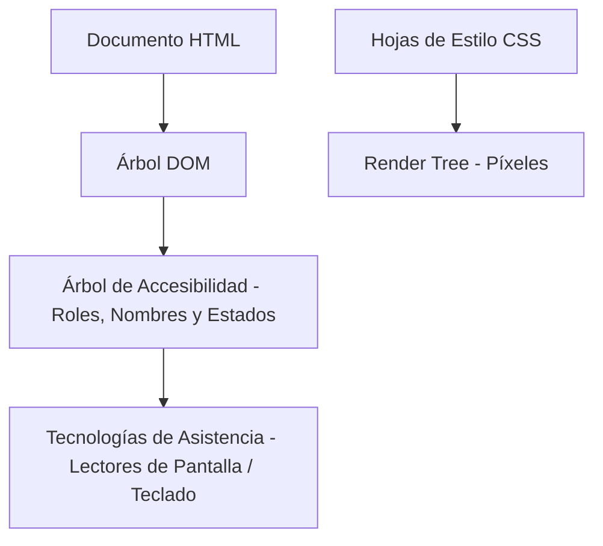

import Callout from '../../../components/ui/Callout.astro';

## El mito del "Checklist al Final"

Existe una creencia muy extendida y dañina en la industria del frontend: considerar que la **accesibilidad web (a11y)** es una auditoría cosmética que se pasa cinco minutos antes de salir a producción agregando un par de atributos `alt=""` a las imágenes.

Tratar la accesibilidad como un parche de última hora es la receta garantizada para acumular deuda técnica masiva:
> **La accesibilidad no es una capa superficial; es una decisión estructural de arquitectura. Si la semántica nativa del documento está rota, ningún script la salvará.**

<Callout type="warning" title="Semántica Nativa > Reescrituras Frágiles">
  El mejor componente accesible es aquel que no necesita hacks de JavaScript para comportarse como lo que siempre debió ser: HTML nativo.
</Callout>

---

## Cómo Piensa el Navegador: El Árbol de Accesibilidad

Muchos desarrolladores desconocen que el navegador no expone el DOM directamente a las tecnologías de asistencia (lectores de pantalla, pulsadores braille, navegación por voz). En su lugar, el motor de renderizado calcula en paralelo una estructura derivada: el **Accessibility Tree** (Árbol de Accesibilidad):



Cuando utilizás etiquetas semánticas nativas (`<button>`, `<nav>`, `<main>`, `<article>`), el navegador asigna automáticamente:
- **Roles nativos:** `role="button"`.
- **Propiedades de teclado:** Inclusión automática en el orden de tabulación (`tabIndex = 0`).
- **Disparadores de eventos:** Respuesta obligatoria tanto a la tecla `Enter` como a la barra espaciadora (`Space`).
- **Estados interactivos:** Manejo de foco y eventos nativos sin una sola línea de código extra.

---

## La Patología del `<div onClick>`

Observá este patrón tristemente habitual en componentes modernos:

```html
<!-- ❌ UN CRIMEN DE INGENIERÍA: Parece un botón, pero para el navegador es solo una caja vacía -->
<div class="btn" onClick="abrirModal()">
  Haz clic aquí
</div>
```

¿Qué acabás de romper al escribir eso?
1. **Perdiste la navegación por teclado:** Un usuario que navega presionando `Tab` jamás podrá posarse sobre ese elemento.
2. **Perdiste la activación por teclado:** Si le forzás un `tabindex="0"`, el `div` recibirá foco pero no responderá a la tecla `Enter` ni a la barra de espacio a menos que agregues un aparatoso manejador de eventos `onKeyDown`.
3. **El lector de pantalla queda ciego:** Para una persona con discapacidad visual, el lector simplemente vocalizará: *"Texto: Haz clic aquí"*, sin indicarle que es un elemento interactivo ejecutable.

Replicar de forma artificial todo lo que el navegador ya te regala gratis en un `<button>` requiere decenas de líneas de código propenso a errores:

```html
<!-- ✅ LA SOLUCIÓN PROFESIONAL: Semántica limpia, accesible y robusta -->
<button type="button" class="btn" onClick="abrirModal()">
  Haz clic aquí
</button>
```

---

## El Crimen de `outline: none` y la Salvación de `:focus-visible`

Durante años, incontables diseñadores y desarrolladores agregaron esta regla global a sus hojas de estilo:

```css
/* ❌ PROHIBIDO: Deja a oscuras a cualquiera que navegue con teclado */
*:focus {
  outline: none;
}
```

El argumento solía ser estético: *"el anillo azul por defecto del navegador se ve feo al hacer clic con el mouse"*. Pero al borrar el indicador de foco, **cegaste por completo a los usuarios de teclado**: al presionar `Tab`, el foco viaja por la página de forma invisible.

### La solución moderna: `:focus-visible`
La pseudo-clase estándar `:focus-visible` es inteligente: solo muestra el anillo de foco cuando el usuario interactúa mediante **teclado o tecnologías de asistencia**, ignorando los clics con el mouse:

```css
/* src/styles/theme.css */
button:focus-visible,
a:focus-visible {
  outline: 2px solid var(--border-focus);
  outline-offset: 2px;
}
```

---

## Por qué los Emojis NO son Iconos de Interfaz

En muchas aplicaciones se suele usar un emoji rápido para salir del paso en botones de acción:

```html
<!-- ❌ ANTI-PATRÓN: Rompe la consistencia y la accesibilidad -->
<button>✏️</button>
```

Tres razones arquitectónicas por las que los emojis jamás deben utilizarse como iconos de UI:
1. **Inconsistencia entre plataformas:** Un emoji cambia de forma, color y estilo drásticamente según el sistema operativo (iOS, Android, Windows o Linux), destruyendo tu sistema de diseño.
2. **Cero herencia tipográfica:** No responden a `currentColor` ni heredan pesos de línea vectoriales coherentes.
3. **Desastre en lectores de pantalla:** Los lectores leen la descripción oficial Unicode del emoji. En lugar de decir *"Editar publicación"*, el lector de pantalla interrumpirá al usuario vocalizando: *"Lápiz escribiendo hacia la izquierda botón"*.

### La alternativa accesible: Iconos SVG de línea con `aria-label`
Para botones de solo icono, utilizamos SVGs vectoriales con `aria-hidden="true"` y un atributo `aria-label` explícito en el botón contenedor:

```astro
<button type="button" aria-label="Editar publicación" class="icon-btn">
  <EditIcon aria-hidden="true" />
</button>
```

---

## Arte Cultural vs. Ruido: El Rol de `aria-hidden="true"`

En **Samsar**, nuestra identidad visual incorpora geometrías y motivos ancestrales mayas de gran riqueza estética. ¿Cómo convivimos con el arte sin saturar a los usuarios de lectores de pantalla?

> **Si un elemento es puramente estético o decorativo, debe ser invisible para el Árbol de Accesibilidad mediante `aria-hidden="true"`.**

```astro
<!-- Motivo maya decorativo: embellece la vista sin ensuciar la lectura accesible -->
<svg aria-hidden="true" class="decorative-pattern opacity-15 pointer-events-none">
  <!-- Trazos geométricos -->
</svg>
```

De este modo, el usuario vidente disfruta del detalle cultural y visual, mientras que el usuario con lector de pantalla navega por el contenido sustantivo sin interrupciones vacías.

---

## Conclusión: El Código Accesible es Mejor Código

La accesibilidad web según **WCAG AA** no es una restricción creativa ni un sacrificio de rendimiento:
- Garantiza contraste matemático estricto (**4.5:1** en texto normal, **3:1** en UI).
- Respeta a usuarios con sensibilidad vestibular desactivando animaciones con `@media (prefers-reduced-motion)`.
- Fomenta la sobriedad, la semántica nativa del navegador y la robustez del código.

Cuando construís accesible desde el primer día, tu código no solo ayuda a personas con discapacidad: **funciona mejor para todos, en cualquier dispositivo y bajo cualquier circunstancia.**
