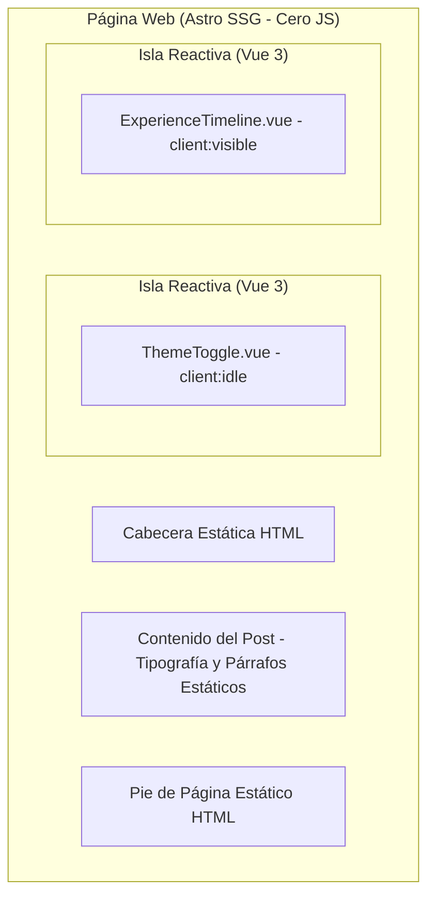
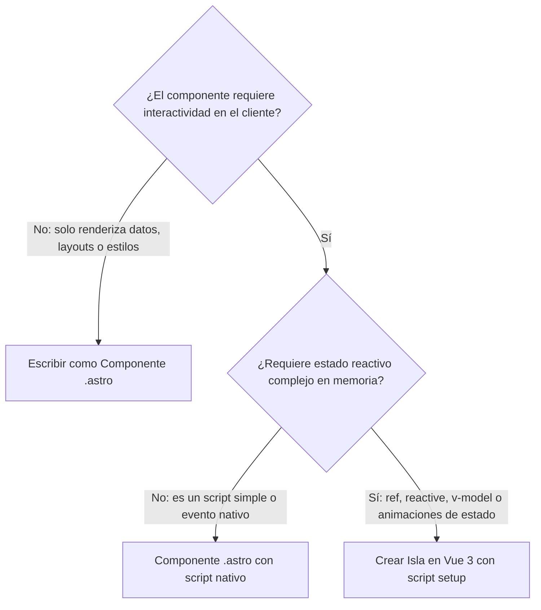

import Callout from '../../../components/ui/Callout.astro';

## El dogma de la SPA y la sobre-ingeniería moderna

Durante más de una década, la industria del desarrollo web operó bajo un reflejo casi condicionado: ante cualquier requerimiento de un nuevo sitio o aplicación, la respuesta por defecto era montar una **Single Page Application (SPA)** monolítica con React, Vue o Angular.

Este enfoque trajo un costo oculto devastador para sitios orientados a contenido, blogs y portafolios:
1. **Sobrecarga de JavaScript innecesario:** El navegador se ve obligado a descargar un runtime completo de 100 a 300 kB simplemente para mostrar texto, títulos e imágenes que jamás cambian.
2. **El costo de la hidratación universal:** El hilo principal (*main thread*) del navegador se bloquea mientras recorre el DOM de arriba a abajo asociando escuchadores de eventos a elementos que son 100% estáticos (como el footer, el layout o un artículo de lectura).
3. **Métricas de Core Web Vitals destrozadas:** En dispositivos móviles de gama media o baja con conexiones inestables, el *Time to Interactive* (TTI) y el *Total Blocking Time* (TBT) caen en picada.

<Callout type="warning" title="Fundamentos antes que Frameworks">
  Construir un sitio de lectura como una SPA completa equivale a encender un motor de combustión pesada para mover una bicicleta. El HTML estático no es una limitación del pasado; es la herramienta más rápida y accesible que existe.
</Callout>

---

## ¿Qué es la Arquitectura de Islas?

Popularizada conceptualmente por Jason Miller (creador de Preact) y perfeccionada por **Astro**, la **Arquitectura de Islas** invierte la premisa de las SPAs:

> **El 100% de la página es HTML y CSS estático renderizado en el servidor por defecto. El JavaScript se reserva exclusivamente para "islas" aisladas de interactividad donde existe estado reactivo real.**



### Los tres superpoderes de este modelo:
- **Cero JS por defecto:** Si una página no tiene componentes interactivos, el cliente recibe exactamente **0 KB de JavaScript**.
- **Aislamiento de fallos:** Si una isla reactiva lanza una excepción no controlada en tiempo de ejecución, **el resto de la página sigue funcionando de forma impecable**. El usuario aún puede leer el contenido, hacer clic en enlaces y navegar.
- **Rendimiento predecible:** Obtener puntuaciones de **100 en Lighthouse** deja de ser una batalla titánica de optimización y pasa a ser la consecuencia natural de la arquitectura.

---

## El Árbol de Decisión: ¿`.astro` o Isla en `.vue`?

En este proyecto establecimos una regla de oro innegociable en nuestras directivas de arquitectura ([ADR-0001](/docs/07-decisions/0001-astro-over-nuxt) y [ADR-0004](/docs/07-decisions/0004-vue-islands)):



* **Usamos `.astro` para:** Layouts (`BaseLayout`, `BlogLayout`), tarjetas de proyectos (`ProjectCard`), tablas de contenido (`TOC`), banners de categorías y botones estáticos.
* **Usamos `.vue` para:** El interruptor de tema (`ThemeToggle.vue`), el menú desplegable móvil (`MobileMenu.vue`) y filtros con estado reactivo.

---

## Hidratación Quirúrgica: Dominando las Directivas de Astro

En una SPA tradicional, todo el código se hidrata al mismo tiempo en el evento de carga. En Astro, el desarrollador decide **cuándo y cómo** se despierta cada isla en el navegador:

### 1. `client:load` (Prioridad Alta)
- **Comportamiento:** Descarga y ejecuta el JavaScript de la isla de inmediato junto con la página.
- **Cuándo usarlo:** Únicamente para elementos de la interfaz críticos que el usuario necesita operar en el primer pantallazo, como el menú de navegación móvil (`MobileMenu.vue`) en pantallas pequeñas.
- **Advertencia:** Cada `client:load` compite por CPU en el primer pintado. Debe usarse con moderación extrema.

### 2. `client:idle` (Prioridad Media)
- **Comportamiento:** La isla se descarga y ejecuta cuando el hilo principal del navegador está libre, utilizando internamente `requestIdleCallback`.
- **Cuándo usarlo:** Para controles que están visibles pero cuya interacción no es inmediata al cargar la página, como nuestro selector de tema (`ThemeToggle.vue`).

```astro
<!-- Hidratación no bloqueante en tiempo libre del browser -->
<ThemeToggle client:idle />
```

### 3. `client:visible` (Hidratación Perezosa por Viewport)
- **Comportamiento:** Mediante `IntersectionObserver`, el navegador **no descarga ni una sola línea de JavaScript de la isla** hasta que el elemento hace intersección con el viewport del usuario.
- **Cuándo usarlo:** Componentes interactivos situados debajo del pliegue (*below-the-fold*), como gráficos interactivos, reproductores multimedia o líneas de tiempo (`ExperienceTimeline.vue`).
- **Impacto:** Si el usuario no baja hasta la sección interactiva, el bundle jamás viaja por la red.

```astro
<!-- Si el usuario no scrollea hasta la experiencia, se transfieren 0 bytes de Vue -->
<ExperienceTimeline client:visible />
```

### 4. `client:media` (Hidratación Condicional por CSS)
- **Comportamiento:** La isla solo se descarga si se cumple una media query específica (ej. `client:media="(max-width: 768px)"`). Ideal para componentes que solo existen en vista móvil.

---

## Conclusión Pedagógica

La Arquitectura de Islas nos enseña una lección de humildad y madurez técnica: **el mejor código en el cliente es el que no necesitas enviar**.

Al combinar **Astro** para la infraestructura estática y **Vue 3** para las islas interactivas, logramos lo mejor de dos mundos: la experiencia de desarrollo reactiva moderna de Vue cuando hace falta, y la velocidad instantánea del HTML puro para todo lo demás.
