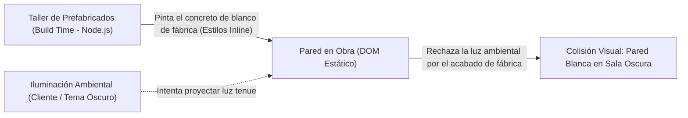
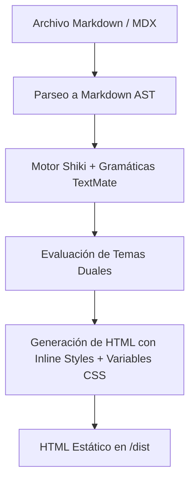

import Callout from '../../../components/ui/Callout.astro';

## La ilusión del resaltado estático

Cuando construimos un blog técnico o una plataforma de documentación moderna, el resaltado de sintaxis es un elemento central de la experiencia de lectura. Durante años, la solución estándar en el ecosistema frontend consistió en cargar librerías del lado del cliente como **Prism.js** o **Highlight.js**:

1. El navegador descarga el HTML plano.
2. Descarga un bundle de JavaScript de 40 a 100 KB solo para colorear código.
3. El motor de JavaScript recorre el DOM en runtime, parsea los bloques de texto con expresiones regulares y muta los nodos, provocando recalculos de estilo (*layout shifts*) y penalizaciones severas en los **Core Web Vitals**.

Astro rompió con este paradigma adoptando **Shiki** como motor de resaltado predeterminado. Shiki no envía un solo byte de JavaScript al cliente: todo el análisis sintáctico ocurre en el servidor o durante el *build* estático utilizando las mismas gramáticas **TextMate** y el motor **Oniguruma** (en WebAssembly) que dan vida a **Visual Studio Code**.

El resultado para el usuario es código perfectamente coloreado desde el primer milisegundo, con cero JavaScript en runtime. 

Sin embargo, esta ventaja arquitectónica introduce una trampa sutil cuando implementamos un selector de tema oscuro/claro dinámico: **el misterio del bloque de código que se niega a oscurecerse y queda con fondo blanco**.

<Callout type="warning" title="Concepts > Code">
  Adoptar herramientas modernas como Shiki sin entender cómo inyectan sus estilos en el árbol DOM conduce inevitablemente a parches apresurados. Para resolver un problema de especificidad, primero hay que comprender la cascada.
</Callout>

---

## La analogía arquitectónica: El muro prefabricado

Para entender qué ocurre realmente, imaginemos la construcción de un edificio:



Cuando compilás tu sitio con Astro:
1. **El taller de prefabricados (Build Time):** Shiki toma el código Markdown y fabrica un bloque de concreto con un acabado de fábrica inamovible. Le aplica estilos directamente a la superficie del elemento (`style="background-color: #fff; color: #24292e;"`).
2. **La iluminación ambiental (Runtime en el Cliente):** El visitante entra a la habitación de noche y activa el interruptor de modo oscuro (`data-theme="dark"`). Las paredes de la sala cambian suavemente a obsidiana y jade gracias a las variables CSS del edificio.
3. **El conflicto:** La pared del bloque de código viene con su propia pintura reflectiva de fábrica aplicada a nivel de ladrillo (*inline style*). La luz ambiental del tema no tiene suficiente potencia para penetrar ese acabado de fábrica. Para el navegador, la orden directa escrita sobre el ladrillo supera cualquier regla general de la habitación.

---

## Cómo piensa Shiki: Del AST al marcado HTML

Veamos qué sucede tras bambalinas en el pipeline de compilación de Astro cuando configuramos temas duales:

```javascript
// astro.config.mjs
export default defineConfig({
  markdown: {
    shikiConfig: {
      themes: {
        light: 'github-light',
        dark: 'github-dark',
      },
      wrap: true,
    },
  },
});
```

Astro ejecuta este proceso en tiempo de compilación:



Cuando Shiki procesa un bloque cercado con triple acento grave (` ```ts `), genera el siguiente HTML en disco:

```html
<pre 
  class="astro-code astro-code-themes github-light github-dark" 
  style="background-color:#fff;--shiki-dark-bg:#24292e;color:#24292e;--shiki-dark:#e1e4e8;overflow-x:auto;" 
  tabindex="0" 
  data-language="typescript"
>
  <code>
    <span class="line">
      <span style="color:#D73A49;--shiki-dark:#F97583">const</span>
      <span style="color:#24292E;--shiki-dark:#E1E4E8"> greeting </span>
      <span style="color:#D73A49;--shiki-dark:#F97583">=</span>
      <span style="color:#032F62;--shiki-dark:#9ECBFF"> "Hola mundo"</span>
      <span style="color:#24292E;--shiki-dark:#E1E4E8">;</span>
    </span>
  </code>
</pre>
```

Observá con atención los atributos `style`:
* **Fondo del contenedor:** `style="background-color:#fff; --shiki-dark-bg:#24292e; ..."`
* **Palabras clave (tokens):** `style="color:#D73A49; --shiki-dark:#F97583;"`

Shiki imprimió de forma indeleble el color claro (`#fff` y `#D73A49`) directamente como estilo inline, y reservó los colores del tema oscuro en **variables CSS personalizadas** (`--shiki-dark-bg` y `--shiki-dark`).

---

## La trampa de la especificidad CSS

En la cascada de estilos de CSS, la **especificidad** define qué regla gana cuando varias compiten por estilizar el mismo elemento.

La escala de especificidad clásica se calcula en cuatro niveles `(A, B, C, D)`:
1. **A:** Estilos inline (`style="..."`) &rarr; Peso `(1, 0, 0, 0)`
2. **B:** IDs (`#identificador`) &rarr; Peso `(0, 1, 0, 0)`
3. **C:** Clases, pseudoclases y atributos (`.astro-code`, `[data-theme='dark']`) &rarr; Peso `(0, 0, 1, 0)`
4. **D:** Elementos y pseudoelementos (`pre`, `span`) &rarr; Peso `(0, 0, 0, 1)`

Cuando alternamos el tema del sitio mediante JavaScript, solemos colocar un atributo en el elemento raíz:

```html
<html data-theme="dark">
```

Si intentamos corregir el fondo en nuestra hoja de estilos con un selector convencional:

```css
/* ❌ NO FUNCIONA: Especificidad (0, 0, 2, 0) vs Inline (1, 0, 0, 0) */
[data-theme='dark'] .astro-code {
  background-color: var(--shiki-dark-bg);
  color: var(--shiki-dark);
}
```

El navegador compara la especificidad:
`Selector [data-theme='dark'] (0, 0, 2, 0) < Estilo Inline (1, 0, 0, 0)`

**El estilo inline gana sin esfuerzo.** El navegador ignora por completo tu selector de tema oscuro, y el bloque de código permanece con su fondo `#fff` cegador en medio de tu diseño oscuro.

---

## La solución arquitectónica: Conectar variables con tokens semánticos

Para quebrar el estilo inline inyectado en el prefabricado, debemos recurrir a la herramienta legítima que el estándar CSS diseñó para la inversión de cascada: la directiva `!important`.

Pero como arquitectos de software, no queremos simplemente aplicar `!important` para usar el fondo por defecto de GitHub (`#24292e`). El azul grisáceo de GitHub desentona por completo con una paleta identitaria basada en **Obsidiana y Jade** (`#131916` / `#1c2420`).

La solución correcta requiere dos acciones:

### 1. Activar las variables de Shiki para los tokens de código
Los `span` individuales (palabras reservadas, cadenas de texto, comentarios) deben adoptar los valores de sintaxis que Shiki ya calculó en build time:

```css
/* src/styles/global.css */
:root:not([data-theme='light']) .astro-code span,
html[data-theme='dark'] .astro-code span {
  color: var(--shiki-dark) !important;
  font-style: var(--shiki-dark-font-style, inherit) !important;
  font-weight: var(--shiki-dark-font-weight, inherit) !important;
  text-decoration: var(--shiki-dark-text-decoration, inherit) !important;
}
```

### 2. Subordinar el contenedor al sistema de diseño
En lugar de aceptar ciegamente `var(--shiki-dark-bg)`, enlazamos el fondo del bloque con nuestro token semántico `--bg-surface`:

```css
/* src/styles/global.css */
:root:not([data-theme='light']) .astro-code,
html[data-theme='dark'] .astro-code {
  color: var(--shiki-dark) !important;
  background-color: var(--bg-surface) !important;
}

html[data-theme='light'] .astro-code {
  background-color: var(--bg-surface) !important;
  color: var(--shiki-light, inherit) !important;
}
```

De esta manera, en tema oscuro el bloque adopta exactamente `#131916` (Obsidiana elevado), y en tema claro `#f5f0e8` (Cielo elevado), garantizando contraste **WCAG AAA** en ambos mundos sin alterar la gramática de sintaxis.

---

## Conclusión

El resaltado de código en tiempo de compilación con Shiki es una de las mayores victorias de rendimiento del ecosistema moderno: nos da fidelidad visual de nivel VS Code con cero sobrecarga de JavaScript en el cliente. 

El tropiezo del fondo blanco no es una falla de Astro ni de Shiki; es una consecuencia natural de la especificidad cuando los estilos inline se encuentran con un toggle de tema dinámico. Entender cómo fluye la cascada nos permite resolver el conflicto con elegancia técnica y respeto por nuestro sistema de diseño.

<Callout type="tip" title="¿Buscás la receta directa paso a paso?">
  Si querés ver el paso a paso práctico con el código listo para copiar en tu proyecto, la configuración de la cabecera y el soporte de navegación accesible con teclado, continuá con la segunda parte:  
  👉 **[Guía Práctica: Cómo Solucionar el Fondo Blanco de Shiki en Modo Oscuro con Tokens de Diseño](/blog/samsar-dev/guia-practica-shiki-modo-oscuro-tokens-astro)**.
</Callout>
