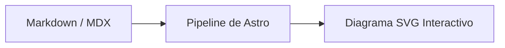

import Callout from '../../../components/ui/Callout.astro';

## El paradigma de "Diagramming as Code" (DaC)

En la documentación técnica tradicional, la arquitectura de software suele explicarse mediante capturas de pantalla o imágenes PNG exportadas de herramientas visuales. Este enfoque tiene tres problemas graves:
1. **Pérdida de sincronización:** Cuando el código cambia, nadie abre la herramienta de diseño para actualizar y reexportar la imagen.
2. **Cero control de versiones:** Un binario `.png` no permite ver diferencias (*diffs*) en un Pull Request ni saber qué cambió.
3. **Mala accesibilidad:** Las imágenes no son legibles por motores de búsqueda ni tecnologías de asistencia sin un trabajo manual exhaustivo.

**Mermaid.js** resuelve esto de raíz al permitir declarar diagramas con sintaxis de texto simple directamente dentro de bloques de código en Markdown:



<Callout type="warning" title="El Desafío de Rendimiento">
  La librería completa de Mermaid supera los 800 kB minificada. Empaquetarla en el bundle global de tu sitio penalizará severamente tus métricas de Core Web Vitals (Lighthouse) en páginas que ni siquiera tienen diagramas.
</Callout>

---

## La Solución: Carga Perezosa Condicional (Lazy Loading)

En **Astro**, el principio fundamental es **Zero-JS by default**. Si una página solo contiene texto y código, no debe transferir ni un solo kilobyte de librerías gráficas.

Para lograr esto en nuestro blog, implementamos un componente `<MermaidBlock />` que opera bajo dos reglas estrictas:

1. **Inspección de presencia:** Solo busca bloques `pre[data-language="mermaid"]` ya generados por el compilador Markdown.
2. **Importación dinámica asíncrona:** Si la lista de bloques es cero, el script se apaga de inmediato. Si encuentra al menos uno, invoca `await import('mermaid')`.

```typescript
// src/components/blog/MermaidBlock.astro
async function initMermaid() {
  const blocks = document.querySelectorAll('.prose-samsar pre[data-language="mermaid"]');
  
  // Regla de oro: 0 bytes de JS si no hay diagramas
  if (!blocks || blocks.length === 0) return;

  // Carga diferida en un chunk separado por Vite
  const mermaid = (await import('mermaid')).default;

  // Inicializar y renderizar...
}
```

---

## Integración con Temas Claro y Oscuro

Uno de los mayores dolores de cabeza al integrar diagramas vectoriales es evitar que queden con fondos blancos brillantes cuando el usuario activa el modo oscuro.

Mermaid permite personalizar temas mediante `themeVariables`. En nuestro diseño, vinculamos las variables de Mermaid directamente a nuestros tokens semánticos de diseño (Jade y Obsidiana para el tema oscuro; Cielo, Sol y Maíz para el tema claro):

```typescript
function getMermaidConfig(isDark: boolean) {
  return {
    startOnLoad: false,
    theme: 'base',
    themeVariables: isDark
      ? {
          darkMode: true,
          background: '#131916',
          primaryColor: '#1c2420',
          primaryTextColor: '#e8e6e1',
          primaryBorderColor: '#00a86b',
          lineColor: '#19c3b0',
        }
      : {
          darkMode: false,
          background: '#f5f0e8',
          primaryColor: '#eae3d5',
          primaryTextColor: '#2b2927',
          primaryBorderColor: '#f4a300',
          lineColor: '#0369a1',
        },
  };
}
```

Además, mediante un `MutationObserver` sobre el atributo `data-theme` del elemento `<html>`, los diagramas detectan en tiempo real cuando el usuario hace clic en el interruptor de tema (`ThemeToggle`) y se re-dibujan al instante sin recargar la página.

---

## Accesibilidad y Resiliencia

El componente `<MermaidBlock />` no destruye el código fuente original. En su lugar:
- Envuelve el SVG resultante en un contenedor con `role="img"` y descripción accesible.
- Agrega un botón de **Copiar código**.
- Añade un acordeón colapsable `<details>` que conserva la sintaxis de origen para que cualquier lector pueda ver o copiar la declaración exacta.
- Si la sintaxis de un diagrama tiene un error tipográfico, captura la excepción y muestra un mensaje amigable en lugar de romper el hilo de lectura del artículo.

En nuestra siguiente entrega, veremos [Mermaid en la Práctica: Modelando Arquitectura de Software y Datos](/blog/samsar-dev/mermaid-casos-reales-arquitectura-software), donde exploraremos diagramas de secuencia, flujogramas de seguridad y máquinas de estado aplicadas a proyectos reales.
