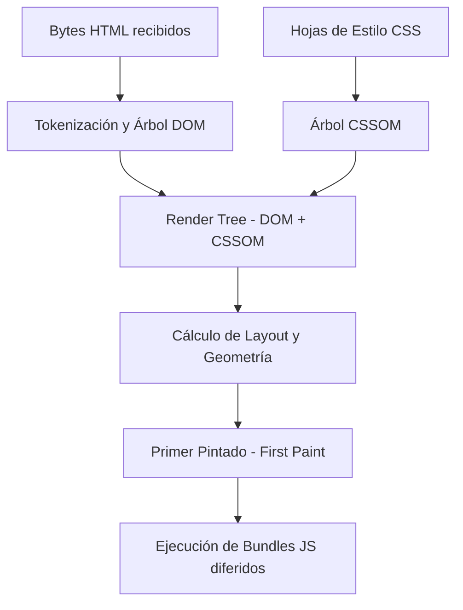

import Callout from '../../../components/ui/Callout.astro';

## El parpadeo que delata la falta de fundamentos

Pocos errores visuales son tan comunes en la web moderna como el **FOUC** (*Flash of Unstyled Content*) al implementar un selector de tema oscuro/claro (*theme toggle*):

Entrás a un sitio técnico de noche con tu sistema operativo configurado en modo oscuro. La pantalla, por una fracción de segundo (100 a 300 milisegundos), estalla en un blanco cegador antes de que la interfaz finalmente se pinte de oscuro.

La reacción habitual del desarrollador junior o intermedio suele ser culpar al framework (*"React tarda en montar"* o *"el hook de Vue tiene retraso"*). La realidad es mucho más profunda:
> **El problema no es el framework. El problema es que intentaste resolver con JavaScript del cliente una decisión que le corresponde al motor de renderizado del navegador.**

<Callout type="warning" title="Concepts > Code">
  Aprender la sintaxis de un framework sin entender cómo viaja el HTML desde el cable hasta los píxeles de la pantalla es programar a ciegas.
</Callout>

---

## Anatomía del Navegador: El Critical Rendering Path

Para entender por qué tu sitio parpadea, debemos repasar cómo un navegador web convierte código en píxeles:



### La trampa de los frameworks
Cuando colocás la lógica de lectura de `localStorage` dentro del ciclo de vida de un componente:

```typescript
// ❌ EL ERROR CLÁSICO: La interfaz parpadeará SIEMPRE
onMounted(() => {
  const theme = localStorage.getItem('theme');
  if (theme === 'dark') {
    document.documentElement.classList.add('dark');
  }
});
```

¿Qué ocurre paso a paso en el navegador?
1. El navegador descarga el HTML y comienza a armar el DOM.
2. Encuentra la hoja de estilos y calcula el CSSOM. Como aún no existe ninguna clase ni atributo en el elemento `<html>`, **aplica el tema por defecto (claro)**.
3. El motor ejecuta el **First Paint**: la pantalla se pinta de blanco.
4. Varios cientos de milisegundos después, el navegador termina de descargar, descomprimir, parsear y ejecutar el bundle de JavaScript (tu SPA o isla).
5. Se dispara el hook `onMounted`, se lee `localStorage` y se muta el DOM.
6. El navegador se ve forzado a recalcular estilos y repintar la pantalla (*Repaint*). **El parpadeo blanco ya ocurrió.**

---

## La Solución de Arquitectura: Bloqueo Síncrono en el `<head>`

Para erradicar el FOUC de raíz, la decisión del tema **debe ejecutarse antes del First Paint**. 

Muchos desarrolladores le temen a la palabra *"bloqueo"*, pero en este caso es una herramienta arquitectónica deliberada: un bloque `<script is:inline>` síncrono colocado en el `<head>`, justo antes de que el motor comience a evaluar el cuerpo de la página:

```html
<!-- src/layouts/BaseLayout.astro -->
<head>
  <!-- Preload de fuentes críticas y metas... -->

  <!-- Script Sincrónico Anti-FOUC (Cero dependencias, ejecución inmediata) -->
  <script is:inline>
    (function () {
      const storedTheme = localStorage.getItem('theme');
      const systemPrefersDark = window.matchMedia('(prefers-color-scheme: dark)').matches;
      const theme = storedTheme || (systemPrefersDark ? 'dark' : 'light');
      document.documentElement.setAttribute('data-theme', theme);
    })();
  </script>
</head>
```

### ¿Por qué este patrón es indestructible?
1. **Pesa menos de 300 bytes:** Su ejecución tarda menos de 1 milisegundo en la CPU.
2. **Se ejecuta antes del cuerpo:** Cuando el motor del navegador lee `<body>` y prepara el primer pintado, el elemento `<html>` ya tiene asignado el atributo `data-theme="dark"`.
3. **Cero parpadeo:** El navegador jamás llega a pintar la versión clara si el usuario eligió la oscura.
4. **Respaldo al sistema operativo:** Si es la primera visita del usuario y `localStorage` está vacío, consulta la media query `prefers-color-scheme` del sistema.

---

## La trampa de copiar tutoriales: `data-theme` vs `.dark`

Un error didáctico clásico ocurre cuando un estudiante copia un snippet de un tutorial de Tailwind v3 que hace `classList.add('dark')` y lo pega en un proyecto que utiliza **tokens semánticos nativos**:

```css
/* src/styles/theme.css */
:root,
[data-theme='dark'] {
  --bg-primary: #0a0e0c;
  --text-primary: #e8e6e1;
  --accent-primary: #00a86b;
}

[data-theme='light'] {
  --bg-primary: #fffdf7;
  --text-primary: #2b2927;
  --accent-primary: #f4a300;
}
```

Si tus estilos resuelven colores mediante selectores de atributo (`[data-theme='dark']`), añadir la clase `.dark` al `<html>` no tendrá **absolutamente ningún efecto visual**.

### Por qué los selectores de atributo superan a las clases:
- **Escalabilidad infinita:** Te permite soportar 2, 3 o 10 temas (`data-theme="sepia"`, `data-theme="high-contrast"`, `data-theme="nord"`) sin modificar los componentes.
- **Componentes limpios:** Ningún botón ni tarjeta necesita condicionales como `isDark ? 'bg-black' : 'bg-white'`. Los componentes simplemente usan `var(--bg-primary)` y delegan la responsabilidad al motor de cascada de CSS.

---

## Conclusión

El rendimiento y la calidad visual no se logran instalando más librerías ni agregando animaciones de transición para disimular retrasos. Se consiguen **respetando el flujo natural de la plataforma web**:

1. Dejá que el `<head>` decida el estado visual antes de pintar.
2. Utilizá tokens semánticos en variables CSS para que el cambio sea instantáneo.
3. Reservá los frameworks e islas reactivas (`ThemeToggle.vue`) exclusivamente para el evento de clic del usuario, no para la inicialización crítica.
