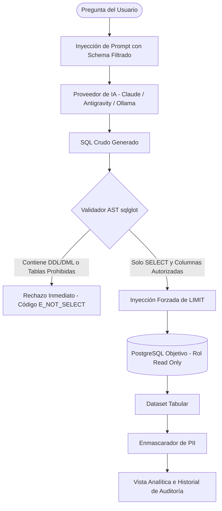
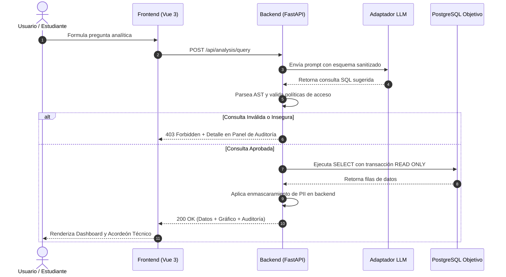
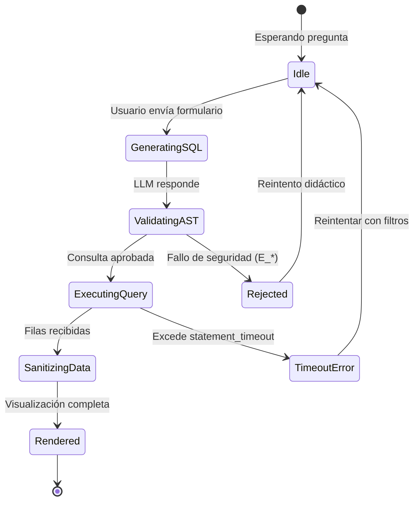
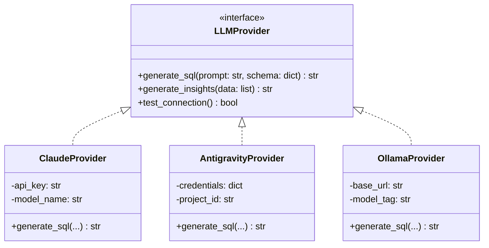

import Callout from '../../../components/ui/Callout.astro';

## La arquitectura debe comunicarse con claridad

Escribir código limpio es solo la mitad del trabajo de un ingeniero de software; la otra mitad es **comunicar las decisiones de diseño a su equipo**.

En el artículo anterior ([Diagramas como Código: Integrando Mermaid en Astro con Alto Rendimiento](/blog/samsar-dev/guia-mermaid-astro-alto-rendimiento)) vimos cómo preparar nuestro sitio para renderizar diagramas vectoriales interactivos. En esta guía, exploraremos cómo utilizar la sintaxis de **Mermaid** para resolver casos reales de documentación arquitectónica, tomando como base nuestra plataforma de analítica segura **Senda|Insight**.

---

## 1. Flujogramas: Modelando tuberías de validación y seguridad

Los flujogramas (`flowchart`) son ideales para representar canales de procesamiento donde intervienen compuertas lógicas y filtros de seguridad deterministas.

Veamos cómo representamos la **defensa en profundidad** frente a consultas generadas por IA:

<Callout type="tip" title="Consejo de Estilo">
  Utilizá subgrafos y formas diferenciadas: paréntesis para eventos de usuario <code>([ ... ])</code>, rombos para bifurcaciones condicionales <code>{'{ ... }'}</code> y cilindros para persistencia <code>[( ... )]</code>.
</Callout>

---

## 2. Diagramas de Secuencia: Protocolos y llamadas asíncronas

Cuando necesitás ilustrar el orden cronológico de mensajes entre múltiples sistemas distribuidos, un diagrama de secuencia (`sequenceDiagram`) es la herramienta adecuada.

Este es el ciclo de vida de una consulta en **Senda|Insight**:

---

## 3. Diagramas de Estado: El ciclo de vida de una consulta

Para modelar máquinas de estado finito o estados reactivos en el frontend, `stateDiagram-v2` permite mapear transiciones sin ambigüedad:

---

## 4. Diagramas de Clases: El Patrón Adapter para Proveedores de IA

Para documentar patrones de diseño orientados a objetos, como el desacoplamiento de motores de IA mediante el patrón Adapter:

---

## Buenas Prácticas al Escribir Diagramas con Mermaid

1. **Priorizá la legibilidad sobre la exhaustividad:** Un diagrama que intenta modelar cada línea de código se vuelve incomprensible. Mostrá las fronteras de responsabilidad, no los detalles triviales.
2. **Utilizá identificadores semánticos:** Nombres como `API`, `LLM`, `DB` en los nodos facilitan la lectura del código fuente en Markdown sin necesidad de mirar la vista previa a cada instante.
3. **Mantené los diagramas cerca del código:** Al vivir directamente en tus archivos `.md` o `.mdx`, cualquier cambio en la arquitectura puede ser actualizado en el mismo commit que modifica el backend o frontend.
