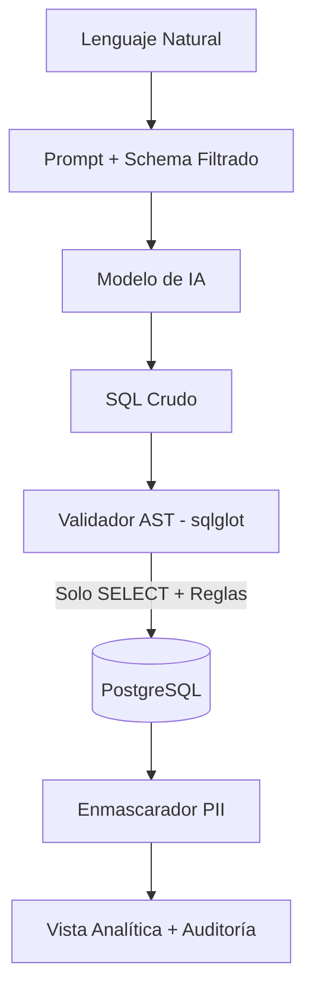

import Callout from '../../../components/ui/Callout.astro';

## El peligro del "Vibe Coding" sin cimientos

En la era de los asistentes de código y modelos generativos, existe una tentación recurrente en estudiantes y desarrolladores: abrir el editor, escribir un prompt informal y esperar que la IA genere una aplicación funcional de punta a punta.

Este enfoque —a menudo denominado coloquialmente *"vibe coding"*— suele estrellarse contra la realidad en cuanto el proyecto requiere **seguridad real, gobernanza de datos y arquitectura escalable**. 

La premisa fundamental que transmito a mis alumnos es clara:
> **El humano lidera la arquitectura; la IA asiste en la ejecución.**  
> Si no tenés claros los conceptos y el árbol de decisiones antes de programar, la IA simplemente acelerará la creación de deuda técnica.

<Callout type="tip" title="La técnica del Sparring (/grill-me)">
  En lugar de pedirle código a la IA, la utilizamos como un interlocutor técnico implacable: un comando interactivo que interroga cada decisión de diseño, exige justificaciones y expone los tradeoffs de cada alternativa.
</Callout>

## Anatomía del proceso: Las 4 bifurcaciones clave de Senda|Insight

Para concebir **Senda|Insight**, nuestra plataforma de inteligencia de negocios Text-to-SQL, iniciamos una sesión de `/grill-me`. En lugar de aceptar la primera sugerencia, recorrimos cada rama del árbol de diseño evaluando pros y contras:

### 1. Identidad y arquitectura de marca: ¿Dónde vive el proyecto?
- **El dilema:** ¿Creamos un ecosistema nuevo para laboratorios educativos o lo sumamos a la suite existente?
- **La decisión:** Sumarlo a la suite **Senda** (`Senda|Core`, `Senda|Loyalty`, `Senda|Concierge`). A nivel pedagógico, los estudiantes aprenden mucho más trabajando sobre un producto diseñado con estándares corporativos que sobre un repositorio de juguete aislado. El canal didáctico se mantiene en el blog de **Samsar**.

### 2. Interacción con la Base de Datos: La trampa del prompt
- **El dilema:** ¿Le pedimos al LLM en su *system prompt* que solo genere consultas `SELECT` seguras?
- **La decisión:** **Defensa en profundidad determinista**. La seguridad nunca se delega al prompt. Diseñamos un validador sintáctico por **Árbol de Sintaxis Abstracta (AST)** con `sqlglot` en el backend para rechazar cualquier mutación, forzar límites de paginación e impedir accesos a tablas restringidas.

### 3. Persistencia e Infraestructura: SQLite vs. Docker Compose
- **El dilema:** Para una PoC rápida, ¿alcanza con un archivo SQLite local?
- **La decisión:** Al orquestar la app en Docker, SQLite puede sufrir por bloqueos y concurrencia. Adoptamos **PostgreSQL Dual**: un contenedor que gestiona `senda_insight_meta` (metadatos y secretos cifrados con AES-256) y `sample_enterprise_db` (datos sintéticos precargados para que los estudiantes clonen y prueben el sistema en 3 minutos con `docker compose up`).

### 4. Gobernanza en 3 Niveles: Más allá del blanco y negro
- **El dilema:** ¿La privacidad de las columnas debe ser binaria (permitido / bloqueado)?
- **La decisión:** Implementar 3 estados por columna:
  1. **Visible:** La IA la conoce y puede proyectarla.
  2. **Enmascarada (Masked):** La IA puede agrupar o filtrar, pero los valores sensibles (PII) se anonimizan en el backend antes de entregarse.
  3. **Bloqueada (Hidden):** Se expurga 100% del esquema que recibe el modelo.

## El resultado: Una especificación viva

El producto de esta sesión de sparring no fue código apresurado, sino una especificación técnica formal y estructurada con diagramas de flujo y matrices de responsabilidad.

<Callout type="note" title="Documento Completo de Especificación">
  Podés consultar el blueprint técnico completo del proyecto en el repositorio:  
  📄 <code>docs/specs/senda-insight-spec-v1.0.md</code>
</Callout>

En la siguiente entrega de esta serie, nos sumergiremos de lleno en la implementación técnica del validador AST: cómo descomponer gramaticalmente una consulta SQL en Python para blindar nuestro backend analítico.
